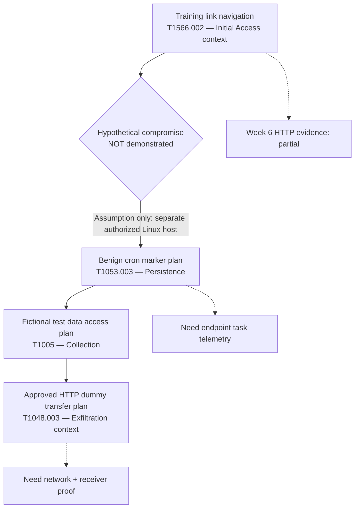

# Week 8 — Adversary Emulation Plan | Phishing Infrastructure CTI

**Project:** Cyber Threat Intelligence Analysis of Phishing Infrastructure  
**Assignment:** Creating a Plan to Emulate an Attacker's Action  
**Deliverable:** Documented plan and MITRE ATT&CK mapping; **no Week 8 attack emulation executed**.  

> **For the defense:** This is a single-page report. Use the table of contents below to jump between the plan, ATT&CK table, attack diagram, Splunk searches, detection gaps, and CALDERA profile. The original sections have been consolidated here.

## At a glance

| Stage | ATT&CK technique | Actual status |
|---|---|---|
| Initial Access | T1566.002 — Spearphishing Link | Partial *prior* Week 6 HTTP observation; no proven compromise |
| Persistence | T1053.003 — Cron | Planned, not executed |
| Collection | T1005 — Data from Local System | Planned, not executed |
| Exfiltration | T1048.003 — Unencrypted Non-C2 Protocol | Planned, not executed |

**Important assumption:** The conceptual persistence stage is on a separate authorized Linux/macOS test host. Week 6's webpage visit does **not** establish endpoint compromise. Week 5's DNS/proxy dataset, Week 6 HTTP evidence and Week 7 public MITRE CAR sample are different sources; do not present them as a single observed attack chain.

## Table of contents

- [Adversary Emulation Plan](#adversary-emulation-plan)
- [ATT&CK Mapping and Validation](#attck-mapping-and-validation)
- [Attack Flow Diagram](#attack-flow-diagram)
- [Splunk Detection Strategy](#splunk-detection-strategy)
- [Detection Gaps and Next Steps](#detection-gaps-and-next-steps)
- [Phishing Infrastructure Context](#phishing-infrastructure-context)
- [CALDERA Conceptual Profile](#caldera-conceptual-profile)
- [Revision Notes](#revision-notes)
- [ATT&CK Navigator visualization](#attck-navigator-visualization)
- [References and evidence status](#references-and-evidence-status)

---

## Adversary Emulation Plan

### 1. Purpose and research question

This Week 8 plan organizes a hypothetical phishing-infrastructure incident into defensible MITRE ATT&CK stages. **Research question:** Can a defender correlate controlled link navigation, task-scheduling changes and staged test-data movement using its available telemetry? This is a *plan* for later assessment, not a claim of attack execution.

### 2. Scope, assets and rules of engagement

- **Environment:** isolated authorized training setup; a web training page; an optional Linux/macOS test endpoint; an offline or lab-only evidence collector and Splunk instance.
- **Authorized data:** a clearly labeled dummy text file, such as `W8_DECOY_ONLY.txt`, containing no personal or secret data.
- **Prohibited:** real credential collection, third-party system access, malware, real phishing delivery, uncontrolled persistence, destructive actions and uploads to public services.
- **Safety controls:** record lab ownership and approvals; prepare snapshots where relevant; stop if network access leaves the isolated environment; review and remove any benign test artifacts after authorized validation.
- **Execution status:** nothing described for Week 8 has been executed unless separately documented with actual logs and timestamps.

### 3. Context and evidence inherited from Weeks 5–7

**Week 5** used Splunk for hypothesis-driven hunting on DNS and proxy event data. **Week 6** demonstrated access to a controlled training link and reviewed HTTP events as *partial* T1566.002 evidence. The training page did not demonstrate a phishing message, payload execution or compromise. **Week 7** studied MITRE CAR mapping with a public JSON host-discovery sample. None of these independently proves persistence or exfiltration in this Week 8 scenario.

### 4. Scenario assumptions and why these techniques were chosen

**Threat-informed basis:** The project focuses on phishing-link infrastructure, not a named actor. T1566.002 was selected because the earlier Week 6 training-link interaction offers a limited, authentic navigation artifact; this does **not** demonstrate message delivery, code execution or foothold. **Assumed-compromise boundary:** for the rest of this *hypothetical* chain only, we assume an independently provisioned and authorized Linux lab host is available. We do not suggest that browsing the link caused control of that host.

**Why Cron?** T1053.003 models persistence on a Linux/macOS endpoint, consistent with the explicitly assumed Unix-like lab host. If a later practical test uses Windows instead, redesign the stage using T1053.005 and update all mappings—not just the label. **Why T1005?** It makes the source of the dummy file explicit. **Why T1048.003?** The planned HTTP transfer is a separate, unencrypted lab data channel, with no C2 channel established. Its mapping is prospective, conditional on a later verified network transfer.

**Causal limitation:** The four stages are a defender-oriented model. No observation in Week 5–7 establishes a causal chain between them.

### 5. Hypothetical sequence

#### Stage A — Initial Access: T1566.002 (Spearphishing Link)

**Threat behavior:** a phishing message directs a target toward a deceptive link.  
**Safe representation:** describe an authorized training-link interaction; reuse Week 6 HTTP evidence only as a prior navigation example. Do not send deceptive messages or assume the user was compromised.  
**Potential signals:** messaging gateway event linked to an URL (if separately available), DNS lookup, proxy/web request, referrer and timestamp.  
**Validation:** establish the lab URL and observed HTTP event; label the broader technique **partial representation** unless message delivery and any subsequent compromise are independently established.

#### Stage B — Persistence: T1053.003 (Scheduled Task/Job: Cron)

**Threat behavior:** a recurring task could re-launch activity on a Unix-like endpoint.  
**Safe representation:** document a harmless scheduled marker task in an **authorized Linux/macOS test machine**; do not provide or deploy a hidden job. This is a future controlled check, separate from the Week 6 web browser demonstration.  
**Potential signals:** crontab configuration change, scheduler/audit event, process execution and timestamp.  
**Validation:** when authorized, compare scheduled-task metadata and any marker result; confirm removal afterwards. No current detection can be claimed from Week 5 proxy logs alone.

#### Stage C — Collection: T1005 (Data from Local System)

**Threat behavior:** an adversary may locate local files before transfer.  
**Safe representation:** create a fictional lab-only marker file and describe its access or staging in a sandbox.  
**Potential signals:** file access (if auditing is enabled), process metadata, timestamp and designated test path.  
**Validation:** confirm that only the declared dummy artifact is referenced, without opening real private files.

#### Stage D — Exfiltration: T1048.003 (Unencrypted Non-C2 Protocol)

**Threat behavior:** data could leave a host using an unencrypted protocol, such as HTTP, that is **not** the existing command-and-control channel.  
**Safe representation:** specify a prospective lab-only HTTP transfer of the dummy artifact to a separately approved local receiver, without implementing it in this Week 8 plan.  
**Potential signals:** outbound HTTP request, destination, source, request method, recorded bytes, time and receiver-side confirmation.  
**Validation:** a future authorized exercise must prove the receiver obtained the exact dummy data and that the transfer was outside any C2 channel. A website visit alone is *not* evidence of exfiltration.

### 6. ATT&CK summary

| Order | ATT&CK tactic | ID | Technique | State |
|---|---|---|---|---|
| A | Initial Access | T1566.002 | Spearphishing Link | Week 6 partial navigation reference |
| B | Persistence | T1053.003 | Scheduled Task/Job: Cron | Planned |
| C | Collection | T1005 | Data from Local System | Planned |
| D | Exfiltration | T1048.003 | Exfiltration Over Unencrypted Non-C2 Protocol | Planned |

These are *conceptual stages*, not evidence that Stage A caused B–D. Details are in [attack_mapping.md](#attck-mapping-and-validation).

### 7. Detection and correlation

Use a time-bound incident timeline joining verified hostname, timestamp, training URL, process/task identifier and **only if available** destination and data-transfer records. Splunk field names differ by sourcetype, so detection queries must first be adapted to actual indexed fields. See [detection_strategy.md](#splunk-detection-strategy).

### 8. CALDERA modeling

In CALDERA terminology an **ability** represents one test behavior; an **adversary profile** sequences reviewed abilities; an **operation** tests them against authorized agents. Our proposed profile describes these objects only. No CALDERA server, agent, ability or operation has been installed or run for Week 8. See [caldera_profile.md](#caldera-conceptual-profile).

### 9. Success criteria and reporting

| Check | What counts as evidence | Current result |
|---|---|---|
| Required phases documented | A/B/D with accurate ATT&CK IDs | Met by this plan |
| Prior link-navigation evidence distinguished | Week 6 HTTP visit labeled partial | Described, not revalidated here |
| Persistence validation | Scheduler change + benign marker + cleanup | Not executed |
| Collection validation | Dummy file access/staging audit | Not executed |
| Transfer validation | Receiver confirmation + network records | Not executed |
| Splunk correlation | Saved searches over real matched events | Not executed for Week 8 |

### 10. Per-stage pass criteria and validation status

**Two separate checks are required:** (a) did the approved behavior occur, and (b) did Splunk receive the corresponding events? Missing logs do not automatically mean the action did not happen.

| Stage | Behavior pass condition (future lab) | SIEM visibility pass condition | Week 8 validation status |
|---|---|---|---|
| A — Initial Access | Approved test-message link and controlled webpage visit correlated by URL and time; endpoint compromise **not** implied | Matching HTTP record in prior Week 6 evidence; mail metadata needed for full T1566.002 | **Partial prior evidence** (navigation only; no Week 8 retest) |
| B — Persistence | Benign named Cron entry documented; scheduled marker appears at expected time; task removed | Same host, task identifier, modification and execution logged in approved endpoint source | **Planned / not executed** |
| C — Collection | Only the designated dummy file is accessed, with path and timestamp confirmed | File audit or approved test activity record received with host and marker identity | **Planned / not executed** |
| D — Exfiltration | Separate lab receiver obtains the correct dummy file; sender/receiver SHA-256 values agree | Matching outbound HTTP event and receiver record with same test ID and time window | **Planned / not executed** |

**Validation worksheet for a later exercise:** record exercise ID, authorized host, OS, source dataset, UTC timestamps/time zone, expected event, observed event count, screenshot/log reference, decision (`pass`, `fail`, `not tested`) and cleanup result. Never report `detected` based on technique mapping alone.

**CALDERA:** conceptual design only; server/agent/operation `Not executed`. **Navigator:** JSON and visual exported; this confirms documentation, not technique execution.

### 11. Limitations and future work

Splunk DNS/proxy events cannot prove an endpoint cron job without additional endpoint telemetry. Week 7 public CAR data is not part of the same attack timeline. The planned Linux/macOS cron behavior cannot be inferred from Windows-only logs. For a future exercise, obtain authorization, choose the actual host/collector configuration, validate field names and compare detection outcomes to the documented criteria. Record failures as failures.

### 12. Conclusion

The plan fulfills the required **Initial Access → Persistence → Data Exfiltration** progression, with Collection added for clarity. Its value is a measurable defensive checklist; its limitation is that it has not yet been executed as a correlated incident.

### Sources

- https://attack.mitre.org/techniques/T1566/002/
- https://attack.mitre.org/techniques/T1053/003/
- https://attack.mitre.org/techniques/T1005/
- https://attack.mitre.org/techniques/T1048/003/
- https://caldera.readthedocs.io/en/stable/
- Local project context: Weeks 5–7 project documentation (consult the original evidence before claiming results).

---

## ATT&CK Mapping and Validation

### Technique map

| Sequence | Tactic | ID | Exact Enterprise technique | Platform | What the lab would represent | Evidence to seek |
|---|---|---|---|---|---|---|
| A | Initial Access | [T1566.002](https://attack.mitre.org/techniques/T1566/002/) | Phishing: Spearphishing Link | Messaging/web; cross-platform | Controlled training URL navigation, not full compromise | Email-link event if available; HTTP/DNS events |
| B | Persistence | [T1053.003](https://attack.mitre.org/techniques/T1053/003/) | Scheduled Task/Job: Cron | Linux/macOS | Clearly labeled benign scheduled marker on an authorized host | Cron/task-change audit and process logs |
| C | Collection | [T1005](https://attack.mitre.org/techniques/T1005/) | Data from Local System | Multiple platforms | Reference only fictional lab file | File access or staging logs if enabled |
| D | Exfiltration | [T1048.003](https://attack.mitre.org/techniques/T1048/003/) | Exfiltration Over Alternative Protocol: Exfiltration Over Unencrypted Non-C2 Protocol | Multiple platforms | Proposed HTTP transfer of dummy data to approved lab receiver | Proxy/network bytes + receiver confirmation |

### Why these four techniques (decision record)

| Technique | Project-specific reason | Key assumption / caveat |
|---|---|---|
| T1566.002 | Reuses the Week 6 training-link HTTP observation to illustrate phishing-link infrastructure | Link visit does not establish phishing email delivery or access to the endpoint |
| T1053.003 | Models scheduled-task persistence on the **assumed Linux lab endpoint** | Entire stage remains hypothetical; Windows would require T1053.005 |
| T1005 | Defines the dummy local file that a later test would access | File existence alone is not proof of collection |
| T1048.003 | Models a **non-C2, unencrypted HTTP** data movement toward a separate authorized receiver | No transfer has occurred; destination receipt and hash are required |

### Validation and evidence status

| Stage | Behavior tested in Week 8? | SIEM observation in Week 8? | Supporting prior work |
|---|---|---|---|
| A | No | No new Week 8 observation | Partial Week 6 HTTP visit |
| B | No | No | None |
| C | No | No | None |
| D | No | No | Week 5 proxy logs are unrelated to any Week 8 transfer |

### Accuracy notes

1. **T1566.002** is primarily a phishing-link delivery technique. Week 6's visited link alone supports only partial emulation and no successful initial compromise.
2. **T1053.003** refers to Cron; use **T1053.005** instead *if* the future target is Windows Task Scheduler. The Week 8 proposal intentionally assumes Unix-like persistence.
3. **T1005** requires a file-collection behavior; the existence of a file without access evidence does not prove collection.
4. **T1048.003** requires exfiltration over an unencrypted **non-C2** channel. Local file copies or normal page views do not satisfy it. A controlled transfer remains a prospective simulation rather than stolen data.
5. Do not conflate ATT&CK **tactics** with *observed incidents*. These IDs classify hypothesized behavior; logs must support claims of actual occurrence.

### Coverage snapshot

| Stage | Prior project coverage | Remaining evidence gap |
|---|---|---|
| A | Week 6 controlled training-link HTTP visit | Delivered message and compromised host not established |
| B | No confirmed cron activity in Weeks 5–7 | Need scheduler/audit events |
| C | No verified Week 8 file-collection run | Need harmless file access evidence |
| D | Prior proxy dataset existed in Week 5 | Need a distinct lab transfer, receiver and matching logs |

---

## Attack Flow Diagram

This diagram maps hypotheses to ATT&CK, **not** an observed successful compromise.



**Legend:** solid arrows = conceptual adversary progression; dashed arrows = evidentiary constraints. The diagram does not claim that any later stages occurred in Week 8.

---

## Splunk Detection Strategy

### Principle

The goal is to specify **what would be checked**, not to claim attacks were performed or detected. The earlier `phishing_logs` index included DNS and proxy-type events, but its exact field extractions and `sourcetype` values should be verified before running these examples. For network evidence, check that records actually contain `url`, `host`, `uri`, `src_ip`, `dest_ip`, `method`, `bytes_out` or their equivalents.

### Data needed

| Phase | Data source | Fields to confirm |
|---|---|---|
| Initial Access | HTTP/proxy and optionally mail gateway | `_time`, training URL/host, `src_ip`, action |
| Persistence | Unix scheduler/audit logs (new source) | `_time`, host, task identity, actor, result |
| Collection | File audit (new source) | `_time`, host, dummy file path, process/action |
| Exfiltration | HTTP/proxy/network logs + receiver audit | `_time`, destination, method, bytes, receiver result |

### Illustrative read-only SPL searches

These are **templates** to adapt to actual data, not verified detections. They do not generate events or perform attacks.

#### Q1: Inventory existing events in the old project index

```spl
index=phishing_logs earliest=-30d
| stats count by sourcetype
| sort - count
```

If old project data is older than 30 days, replace the time range with an explicitly recorded historical period or `All time` in Splunk UI.

#### Q2: Find the controlled training URL if HTTP fields exist

```spl
index=phishing_logs earliest=0
| eval requested_url=coalesce(url, uri, request, http_url)
| search requested_url="*training*"
| table _time sourcetype src_ip requested_url action status
| sort _time
```

**Interpretation:** this identifies records matching an example training substring. Confirm the exact authorized hostname and field names using the original Week 6 data; a match proves navigation/logging, not compromise.

#### Q3: Baseline traffic destinations (exploratory only)

```spl
index=phishing_logs earliest=0
| eval destination=coalesce(dest_ip, dst_ip, destination_ip, host)
| stats count by destination sourcetype
| sort - count
```

**Interpretation:** possible network investigation starting point; no exfiltration detection claim.

#### Planned Q4: Unix scheduler records — only if indexed later

```spl
index=<LAB_ENDPOINT_INDEX> sourcetype=<VERIFIED_CRON_SOURCETYPE>
| table _time host user action message
| sort _time
```

`<...>` placeholders must be replaced after checking real ingest configuration. This is a monitoring *design*, not a runnable SPL query until configured.

#### Planned Q5: Correlate approved transfer events — only if indexed later

```spl
index=<LAB_NETWORK_INDEX> sourcetype=<VERIFIED_HTTP_SOURCETYPE>
| table _time src_ip dest_ip http_method url bytes_out status
| sort _time
```

For a future lab test, inspect the exact approved destination and compare source/request metadata to the receiver-side record. Do not equate arbitrary POSTs with exfiltration.

### Verification protocol (proposed)

Before interpreting any search result, record which actual `index`, `sourcetype`, time zone and field names exist in that dataset. Capture a one-event raw sample and use it to adjust SPL. Historical DNS/proxy logs and public Week 7 CAR data must not be joined as a single incident.

| Stage | Required log prerequisite | Expected correlation key | Behavior evidence | Splunk evidence |
|---|---|---|---|---|
| Link | Week 6 HTTP/proxy, optionally authorized mail logs | Exact training URL + timestamp | Approved page visit | Matching HTTP event; message not verified |
| Cron | Linux/macOS scheduler/audit ingest | Host + task marker + time | Named task and marker result | Task change and run visible in indexed source |
| Collection | File-system auditing for designated lab path | Host + dummy file path + time | Confirmed access of synthetic file | Audited access event, not just file creation |
| Transfer | Outbound web/network + separate receiver logs | Sender + destination + test ID + hash | Receiver accepts exact dummy file | Network request with relevant destination and time |

**Decision rule:** `Behavior pass` and `SIEM visible` are separate yes/no columns. A `false positive` means a search matched unrelated benign activity; `no telemetry` is an instrumentation gap, not a confirmed defense failure. No tested counts, precision or recall can be claimed for Week 8.

### Success metrics for future exercise

- **Visibility:** telemetry captured at each stage (yes/no).
- **Correctness:** matching hostname, URL, marker ID, time range and receiver confirmation.
- **Detection:** relevant rule or analyst query returns the expected records (yes/no), with screenshots and timestamps if run.
- **Cleanup:** no scheduled test artifacts left behind (yes/no).

### Expected gaps

Current Week 5 proxy and DNS logs do not alone establish cron changes or local file reads. Additional authorized endpoint auditing would be required. The Week 7 public CAR sample should not be correlated into the same timeline as if it were produced by the Week 8 scenario.

### Reference

- https://attack.mitre.org/detectionstrategies/DET0149/

---

## Detection Gaps and Next Steps

**Assessment status:** design review; **not** a measured Week 8 detection experiment. No Week 8 CALDERA operation or exfiltration has been run.

| Stage | Current evidence from prior work | Gap / uncertainty | Proposed defensive validation | Status |
|---|---|---|---|---|
| Infrastructure context (T1583.001, T1608.005) | Week 5 DNS/proxy datasets; Week 6 training webpage | No verified domain acquisition, CT/RDAP chronology, or complete phishing infrastructure timeline | Enrich *known, permitted* domains with public contextual data and check fields against raw log records | Proposed |
| Initial Access (T1566.002) | Week 6 HTTP training-link visit and Splunk search results | No email delivery evidence, no demonstrated compromised host | Link approved test-message metadata to a test URL visit only if both sides are logged | Partially observed / proposed |
| Persistence (T1053.003) | No Week 8 host scheduler telemetry | No cron creation/execution events and no host-to-link chain | Use a non-executing sample of scheduler telemetry or an approved benign lab marker; validate source fields before writing an SPL rule | Not tested |
| Collection (T1005) | No recorded collection actions | Cannot identify real file access or source host | Use fictional file activity sample with known timestamps and explicitly synthetic labels | Not tested |
| Exfiltration (T1048.003) | Prior proxy data not tied to Week 8 operation | No proof of file transfer, receiver match, or outbound non-C2 channel | In a future authorized lab, compare sender, receiver, byte count and timestamps for a harmless test file | Not tested |

### Defensive priorities

1. **Evidence integrity:** label public, synthetic, and live lab data separately; document source and collection time.
2. **Field validation:** inspect actual Splunk fields (`index`, `sourcetype`, URL/host/IP fields) before adapting searches. Do not assume Linux host logs are in the earlier `phishing_logs` index.
3. **Cross-stage correlation:** correlate only events that truly share test host identifiers and a defensible time window.
4. **Coverage tracking:** record `planned`, `observed`, `detected`, and `not tested` separately. A mapped ATT&CK technique does not imply a successful detection.
5. **Safety and cleanup:** any later simulation must use an isolated authorized machine and fictional data, with artifacts removed afterwards.

### Week 9 handoff (proposal only)

Validate one benign telemetry example for persistence and one for data-transfer visibility; preserve source log snippets and annotate false positives / missing fields. CALDERA may be investigated separately but is not required to claim Week 8 documentation complete.

### Validation status summary (as of Week 8)

| Component | Documentation completed | Practical behavior | Confirmed Splunk detection |
|---|---|---|---|
| Week 6 training-link reference | Yes | Earlier controlled navigation only | Earlier HTTP evidence; not a Week 8 test |
| Cron persistence | Yes | Not executed | Not tested |
| Dummy-file collection | Yes | Not executed | Not tested |
| Non-C2 transfer | Yes | Not executed | Not tested |
| CALDERA operation | Conceptual profile | Not deployed | Not tested |
| Navigator layer | JSON + SVG prepared | Not an operation | Not a detection result |

#### Reporting standard

A later test report should use one row per phase with: authorized host, run ID, expected event, actual evidence path, `behavior pass`, `SIEM visible`, analyst interpretation, and cleanup confirmation. If any of those fields are unknown, state **not verified** rather than assuming success.

---

## Phishing Infrastructure Context

**Status:** analytical extension to the Week 8 plan, not an executed infrastructure setup.

### Why infrastructure matters

Our project concerns the indicators surrounding phishing links: DNS queries, HTTP destinations, URL structure, and related hosting context. Week 6 demonstrated navigation to an authorized training link. It did **not** demonstrate registering a deceptive domain, delivering an email, credential collection, or endpoint compromise.

### ATT&CK context (pre-attack)

| Technique | Adversary behavior in ATT&CK | Safe representation in this project | Status |
|---|---|---|---|
| T1583.001 — Acquire Infrastructure: Domains | Obtaining a domain for an operation | Describe domain-related indicators (registration dates, RDAP, passive DNS) using an illustrative example or public defensive dataset; no domain acquisition | Context only; **not emulated** |
| T1608.005 — Stage Capabilities: Link Target | Preparing the webpage a link points to | Refer to the authorized training webpage already used in Week 6 | Related training page observed; full adversary technique **not demonstrated** |
| T1566.002 — Phishing: Spearphishing Link | Delivering a phishing link to a target | Reuse the Week 6 training-link visit as partial browser/HTTP evidence | Partial observation; delivery and compromise **not demonstrated** |

### CTI signals and limits

- **DNS:** queried domain, timestamp, resolved IP if available; an unusual domain is an indicator, not proof of maliciousness.
- **HTTP/proxy:** destination host, path, status code, timestamp, user agent if logged; a `200` response confirms server response, not compromise.
- **RDAP/WHOIS and certificate transparency:** useful *external* context when actual domain identifiers are available; do not fabricate registration age or certificate history.
- **Correlation:** tie DNS and HTTP on a common time window and network identity only when both fields exist in the source data.

### Safe visual evidence

A neutral mock webpage can illustrate a *training link target* with a visible `TRAINING / NO LOGIN` label and **no credential input or collection**. Such a mockup is illustrative and must not be described as a captured phishing kit.

### References

- https://attack.mitre.org/techniques/T1583/001/
- https://attack.mitre.org/techniques/T1608/005/
- https://attack.mitre.org/techniques/T1566/002/

---

## CALDERA Conceptual Profile

> Planning artifact, **not executable CALDERA YAML**. No agent, server, operation, payload or ability is deployed.

### Why CALDERA is mentioned

MITRE CALDERA represents tests as **abilities**, combines abilities into an **adversary profile**, and runs that profile in an **operation** against authorized agents. The **planner** controls ordering, while the resulting operation artifacts can be reviewed for defensible observations.

### Proposed profile

**Name:** `Phishing-Infrastructure-Visibility-W8`  
**Objective:** test whether a defender can observe the planned phishing-navigation, scheduled marker, dummy-data access, and controlled lab transfer sequence.

| Order | Conceptual ability label | ATT&CK | Planned harmless representation |
|---|---|---|---|
| 1 | `document-training-link` | T1566.002 | Compare recorded training URL and HTTP observation |
| 2 | `inspect-scheduled-marker` | T1053.003 | Review a labeled benign task on an authorized Unix-like lab host |
| 3 | `inspect-decoy-file-access` | T1005 | Review access to fictional marker data |
| 4 | `inspect-local-http-transfer` | T1048.003 | Review a prospective dummy-data HTTP transfer and receiver evidence |

These labels are descriptions only. CALDERA abilities require concrete, reviewed definitions and applicable agents; a manual external email/web observation may need **out-of-band evidence** rather than pretending that an endpoint ability reproduced phishing delivery.

### Hypothetical operation settings

| Property | Proposed setting |
|---|---|
| Network | Isolated and explicitly authorized laboratory |
| Endpoint | Linux/macOS test host for Cron stage |
| Execution | Manual approval before each separately reviewed benign test |
| Data | Dummy test markers only |
| Reporting | Separate per-stage evidence, timestamps and detection results |
| Cleanup | Stop exercise and remove all test artifacts |
| Current status | NOT DEPLOYED / NOT EXECUTED |

### Model boundaries

- An ATT&CK technique ID is not automatically an available CALDERA ability.
- A visited link is not a verified phishing compromise.
- A created scheduled job is not proof it ran or survived reboot.
- A copied local file is not network exfiltration.
- An ordinary HTTP request is not proof of T1048.003 without verified data movement and non-C2 context.

### References

- https://caldera.readthedocs.io/en/stable/
- https://attack.mitre.org/

### Run / export status

| Requested artifact | Actual Week 8 status |
|---|---|
| Executable CALDERA YAML | **Not created** (labels above are conceptual) |
| CALDERA server and Sandcat agent | **Not deployed** |
| Operation results or screenshots | **Not available** |
| ATT&CK Navigator layer | **Created separately as documentation** |

Do not describe the `caldera_profile.md` file as an exported YAML or operation result.

---

## Revision Notes

- Explained the assumed-compromise transition between an HTTP link visit and a separate hypothetical Linux endpoint.
- Added project-specific reasoning for four ATT&CK IDs; kept Cron (Linux/macOS), not Windows Scheduled Task.
- Added per-stage behavior and SIEM pass/fail criteria; all Week 8 behavior remains not executed.
- Added explicit evidence prerequisites and no-telemetry-versus-no-detection distinction.
- Added CALDERA export status (conceptual only), detection gap status table, and a README summary.
- Included the user's exported Navigator SVG when available.
- No new operational logs or attack results are claimed.

---

## ATT&CK Navigator Visualization


*Figure 1. ATT&CK Navigator layer for the proposed Week 8 scenario. Colors identify selected stages and their documented scope; they are not evidence of successful execution or detection.*

Import the editable layer file [`attack-navigator-layer.json`](attack-navigator-layer.json) into [MITRE ATT&CK Navigator](https://mitre-attack.github.io/attack-navigator/) using **Open Existing Layer → Upload from local**.

## References and Evidence Status

The primary references are [MITRE ATT&CK](https://attack.mitre.org/), [MITRE CALDERA documentation](https://caldera.readthedocs.io/en/stable/), and the separate Week 5–7 project records. Week 8 itself is a planning deliverable. No CALDERA operation, Cron persistence run, file collection experiment or HTTP exfiltration trial is claimed. The Week 6 visit only supports partial URL navigation behavior.
