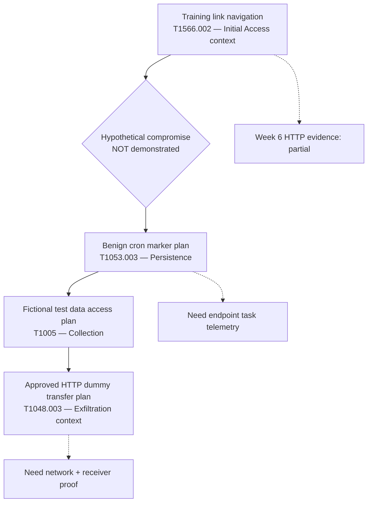

# Week 8 — Conceptual Attack Flow

This diagram maps hypotheses to ATT&CK, **not** an observed successful compromise.

**Legend:** solid arrows = conceptual adversary progression; dashed arrows = evidentiary constraints. The diagram does not claim that any later stages occurred in Week 8.
