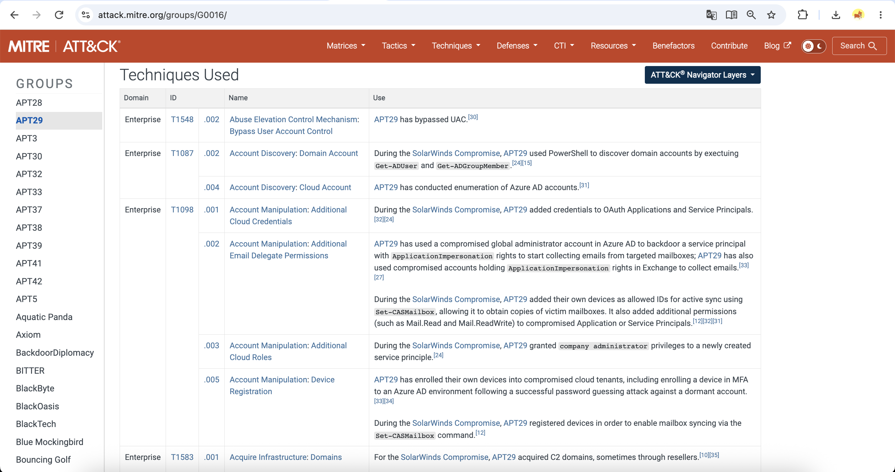
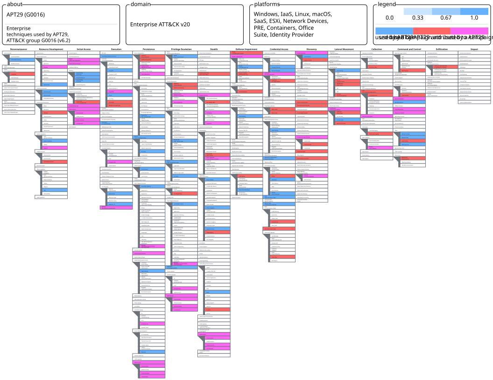

# Week 10 — Learning APT Techniques: APT29 TTP Analysis and MITRE ATT&CK Mapping

## 1. Introduction

This week focuses on studying an Advanced Persistent Threat (APT) group through public threat reports and mapping its observed techniques to the MITRE ATT&CK framework.

Our group project, **Cyber Threat Intelligence Analysis of Phishing Infrastructure**, investigates indicators and activities associated with phishing campaigns. We selected **APT29**, because phishing is one of the initial access methods documented for this group, and its infrastructure (domains, compromised sites, cloud services) is a natural subject for CTI analysis.

This week is a **desk-based analysis**. No attacks or tests were executed. The findings are linked to the Week 9 Splunk laboratory to identify telemetry gaps; the existing tests cannot quantify general detection coverage.

## 2. Objectives

- Study a documented APT group (APT29) using public CTI sources.
- Map observed techniques to MITRE ATT&CK tactics and techniques.
- Identify the techniques relevant to phishing and its infrastructure.
- Compare APT29 techniques with the techniques tested in Week 9.
- Identify detection gaps in our Splunk laboratory.

## 3. Group Profile: APT29

| Item | Information |
|---|---|
| MITRE ATT&CK group ID | G0016 |
| Associated names | Cozy Bear, The Dukes, NOBELIUM, Midnight Blizzard, UNC2452, StellarParticle, Dark Halo, SolarStorm (vendor naming differs; see the MITRE group page) |
| Attribution (as stated by MITRE and other sources) | Russia's Foreign Intelligence Service (SVR). This is the attribution made by the cited sources, not our own conclusion |
| Typical targets | Governments, diplomatic entities, think tanks, research organizations, IT service providers |
| Motivation | Long-term espionage and intelligence collection |
| Notable activity | SolarWinds supply-chain compromise (2020), Operation Ghost, spearphishing and cloud-focused activity reported in recent years |

> Group names are assigned by different vendors and may not overlap perfectly. We use the MITRE ATT&CK group name APT29 for consistency.

## 4. Sources

| Source | Use in this report |
|---|---|
| MITRE ATT&CK — Group G0016 (APT29): https://attack.mitre.org/groups/G0016/ | Primary source for the technique mapping |
| Mandiant — [Tracking APT29 Phishing Campaigns](https://cloud.google.com/blog/topics/threat-intelligence/tracking-apt29-phishing-campaigns/) (2022) | Documented embassy-themed phishing, compromised sender addresses and misuse of legitimate cloud services |
| CrowdStrike — [COZY BEAR Adversary Profile](https://www.crowdstrike.com/en-us/adversaries/cozy-bear/) | Group identification, motivations, attribution assessment and related names |
| Mandiant — [APT1: Exposing One of China's Cyber Espionage Units](https://www.mandiant.com/sites/default/files/2021-09/mandiant-apt1-report.pdf) (2013) | Methodological comparison only; APT1 is a **different** group and is not evidence of APT29 techniques |
| Mandiant — [APT29 Uses WINELOADER to Target German Political Parties](https://cloud.google.com/blog/topics/threat-intelligence/apt29-wineloader-german-political-parties) (2024) | Additional campaign context; includes a documented reference to T1082 in a specific campaign |

> The technique table was checked against the **MITRE ATT&CK G0016 group page (version 6.2, modified July 31, 2026)**. Vendor reports provide additional context. The Mandiant APT1 report is included as syllabus background, not as evidence about APT29.

## 5. TTP Mapping to MITRE ATT&CK

The table lists techniques associated with APT29 in MITRE ATT&CK that are relevant to phishing and to our lab. It is a selection, not the full list.

| Tactic | ATT&CK ID | Technique | Use by APT29 (summary) | Relevance to our project |
|---|---|---|---|---|
| Resource Development | T1584.001 | Compromise Infrastructure: Domains | Compromised domains used for C2 during the SolarWinds campaign | Infrastructure analysis: compromised legitimate domains are harder to block by reputation |
| Resource Development | T1587.001 | Develop Capabilities: Malware | Custom malware families developed for operations | Payload delivery behind phishing |
| Resource Development | T1583.006 | Acquire Infrastructure: Web Services | APT29 used legitimate services such as Dropbox and Constant Contact in operations | Legitimate service abuse, hosted links, and web-service traffic |
| Resource Development | T1586.002 | Compromise Accounts: Email Accounts | Compromised email accounts used to support phishing campaigns | Sender trust, mailbox audit trails and email-header correlation |
| Initial Access | T1566.001 | Phishing: Spearphishing Attachment | Malicious attachments sent to selected targets | Core phishing technique |
| Initial Access | T1566.002 | Phishing: Spearphishing Link | Links leading to malicious content | Core phishing technique; URL and domain IOCs |
| Initial Access | T1566.003 | Phishing: Spearphishing via Service | APT29 used Constant Contact to distribute phishing emails | Abuse of trusted email delivery services |
| Execution | T1204.002 | User Execution: Malicious File | Victim opens or runs a delivered file | Follows successful phishing |
| Execution | T1059.001 | Command and Scripting Interpreter: PowerShell | PowerShell used for execution | Conceptually related to Week 9 T1059.004 Unix shell; distinct subtechnique and platform |
| Defense Evasion | T1027.006 | Obfuscated Files or Information: HTML Smuggling | APT29 embedded files within HTML attachments to obscure payload delivery | HTML attachment inspection, browser and endpoint telemetry |
| Defense Evasion | T1553.005 | Subvert Trust Controls: Mark-of-the-Web Bypass | Embedded ISO/VHDX content in HTML to evade origin-based trust controls | Attachment and file provenance telemetry |
| Persistence | T1546.003 | WMI Event Subscription | WMI subscriptions used for persistence | Host telemetry needed beyond process execution |
| Persistence | T1547.001 | Registry Run Keys / Startup Folder | Registry Run keys used to maintain access | Windows registry monitoring; not tested |
| Persistence | T1136.003 | Create Account: Cloud Account | Creation of cloud accounts (e.g. Azure AD) | Cloud identity monitoring |
| Privilege Escalation | T1548.002 | Bypass User Account Control | UAC bypass | Windows telemetry |
| Credential Access | T1110.003 | Brute Force: Password Spraying | Password spray attacks against accounts | Authentication log monitoring |
| Credential Access | T1003.002 | OS Credential Dumping: Security Account Manager | MITRE reports APT29 used the Windows `reg save` command to save registry hives | Windows sensitive registry access telemetry; not tested |
| Credential Access | T1003.004 | OS Credential Dumping: LSA Secrets | APT29 has extracted LSA-related secrets from Windows registry hives | Windows credential-access telemetry; not tested |
| Credential Access | T1003.006 | OS Credential Dumping: DCSync | APT29 used privileged access to replicate directory credential data during SolarWinds | Domain controller telemetry; not tested |
| Collection | T1560.001 | Archive Collected Data: Archive via Utility | Stolen data compressed (e.g. 7-Zip) before exfiltration | Process execution monitoring |
| Command and Control | T1090.004 | Proxy: Domain Fronting | MITRE documents older APT29 activity using Tor's meek domain-fronting plugin to obscure C2 destinations | Network CTI: proxy/TLS infrastructure and traffic patterns |

> The "Use by APT29" column summarizes the MITRE [G0016 Techniques Used table](https://attack.mitre.org/groups/G0016/). Not all techniques belong to the same campaign. For campaign-specific evidence, see the references cited by MITRE and the Mandiant report.

### 5.1 Mapping artifacts and optional ATT&CK Navigator

For a concise, defense-friendly mapping table and evidence trace, see [MITRE_ATTACK_Mapping.md](MITRE_ATTACK_Mapping.md). The [Navigator layer JSON](attack-navigator-layer.json) contains selected APT29 techniques from the mapping table and can be imported into [MITRE ATT&CK Navigator](https://mitre-attack.github.io/attack-navigator/). The layer is an analytical visualization, **not proof of executing these techniques**.

The optional Navigator screenshot `screenshots/w10_navigator_apt29.png` must be captured from the live Navigator interface after importing the layer; it has not yet been submitted.

## 6. Phishing and Infrastructure Focus

This section connects the APT29 analysis to the project topic.

**Phishing as initial access.** MITRE lists both spearphishing attachments (T1566.001) and links (T1566.002) for APT29. Mandiant's [2022 analysis](https://cloud.google.com/blog/topics/threat-intelligence/tracking-apt29-phishing-campaigns/) documented embassy-themed phishing and malicious HTML attachments that delivered additional files. Reports on other Russia-nexus phishing campaigns should not automatically be attributed to APT29.

**Infrastructure behaviors relevant to CTI.**

- Use of compromised legitimate domains (T1584.001) means domain reputation alone is not enough for detection.
- Use of trusted services and domain fronting (T1090.004) hides C2 destinations behind legitimate providers.
- Cloud accounts and identity abuse (T1136.003, T1110.003) shift detection toward authentication logs.

**Infrastructure indicators we would collect for a phishing investigation.**

| Indicator type | What to check |
|---|---|
| Domain | Registration date and registrar, WHOIS history, similarity to the target brand |
| URL | Redirect chains, hosting platform, page content |
| IP / ASN | Hosting provider, other domains on the same IP (passive DNS) |
| TLS certificate | Issuer, issue date, reused certificates across domains |
| Email | Sender domain, SPF/DKIM/DMARC results, headers |

> We did not collect or publish real APT29 IOCs in this report. IOCs change quickly, and current ones should be taken from the original vendor reports.

## 7. Link to Week 9 (Atomic Red Team and Splunk)

| APT29-relevant technique | Week 9 status | Observation |
|---|---|---|
| T1059 | **Partially tested**: T1059.004 (Unix shell) on Kali Linux | APT29 is documented using PowerShell (T1059.001) on Windows. Our lab did not test PowerShell |
| T1082 | **Tested** on Kali Linux; **not listed in the current G0016 group technique table** | Two selected events were manually forwarded and retrieved in Splunk. **Mandiant's April 2022 APT29 phishing report lists T1082** in its campaign TTP appendix; the 2024 WINELOADER report also lists it. We did **not** reproduce the campaign or establish its exact commands. |
| T1003.002 / T1003.004 / T1003.006 | **Theoretical only** | These Windows-specific subtechniques are listed on G0016. No credential access was performed. |
| T1003.008 | **Theoretical only** (Week 9 Linux discussion) | **Mandiant's April 2022 APT29 phishing report lists T1003.008** in its broader TTP appendix, although the current G0016 group table does not list it. Our lab performed no credential access. |
| T1566.001 / T1566.002 | **Not tested** | Phishing delivery is outside the scope of our endpoint lab; covered by CTI analysis of URLs and domains |
| T1584.001, T1090.004 | **Not applicable to atomic tests** | Infrastructure techniques are analyzed through CTI (domain, IP, certificate data), not emulated |
| T1546.003, T1547.001, T1548.002, T1560.001 | **Not tested** | Windows persistence/privilege and archival behaviors require telemetry not available in this lab |

### 7.1 Detection gap summary for our Splunk laboratory

- **Platform gap:** the lab uses Linux (Kali); most of the listed APT29 techniques are documented on Windows, so Sysmon and Windows Event Logs would be needed.
- **Telemetry gap:** only `execve` process execution is monitored. File access, WMI, authentication and network events are not collected.
- **Pipeline gap:** events were forwarded manually, and the alert was validated on a synthetic event only (see Week 9 limitations).
- **Rule gap:** the alert condition `command="/bin/sh"` is narrow.

These gaps mean we cannot claim that our lab detects APT29 techniques. The comparison shows what telemetry would have to be added. The April 2022 Mandiant campaign appendix offers a documented **technique-level** link to our T1082 test and theoretical T1003.008 discussion; it is not evidence of matching APT29 payloads, commands, infrastructure, or end-to-end detection.

### 7.2 Proposed next steps

1. Add a Windows VM with Sysmon and forward its logs to Splunk using a Universal Forwarder.
2. Test PowerShell-based atomic tests (T1059.001) in an isolated environment.
3. Consider a separate, authorized Linux file-access monitoring exercise using harmless test files; this would demonstrate an auditing capability, not reproduce APT29 credential dumping.
4. Create SPL queries for authentication anomalies (e.g. many failed logins across accounts) as a basis for password-spray detection.

## 8. Limitations

- This is a desk analysis based on public reports and the MITRE ATT&CK page. We did not observe real APT29 activity.
- Attribution and group naming come from the cited sources and may be disputed or differ between vendors.
- The technique table is a selection relevant to our project, not a complete profile.
- MITRE ATT&CK entries are summaries of public reporting and may change between versions.
- The lab does not emulate APT29 as a full adversary. Only isolated technique tests were run in Week 9.
- No IOCs were validated against live infrastructure.

## 9. Conclusion

Week 10 analyzed APT29 (G0016) and mapped selected techniques to MITRE ATT&CK, with a focus on phishing and infrastructure behaviors: spearphishing (T1566), compromised domains (T1584.001), and the use of trusted services (T1090.004).

Comparing this profile with the Week 9 laboratory showed that our Linux-based Splunk setup covers only a small part of the APT29 technique set. It demonstrates manual ingestion and retrieval of selected Unix shell and system information discovery events, while phishing delivery, Windows persistence and credential access remain outside the tested scope.

The analysis supports the project direction: phishing infrastructure indicators from CTI should be combined with endpoint and authentication telemetry in the SIEM to give analysts more context.

## 10. Screenshots and Evidence

The following evidence supports the APT29 threat intelligence analysis and MITRE ATT&CK mapping.

### 10.1 MITRE ATT&CK Group Profile

The screenshot shows the official MITRE ATT&CK APT29 (G0016) page, including the Techniques Used table.

### 10.2 ATT&CK Navigator

An ATT&CK Navigator layer was exported to visualize the documented techniques associated with APT29.

The Navigator visualization represents publicly documented techniques, not techniques executed during Week 10.

### 10.3 Supporting Artifacts

- [MITRE ATT&CK Mapping Table](MITRE_ATTACK_Mapping.md)
- [ATT&CK Navigator JSON Layer](attack-navigator-layer.json)
- [Week 9 Laboratory Results](../week9/README.md)

## 11. References

1. MITRE ATT&CK — APT29 (G0016, version 6.2): https://attack.mitre.org/groups/G0016/
2. Mandiant — Tracking APT29 Phishing Campaigns (2022): https://cloud.google.com/blog/topics/threat-intelligence/tracking-apt29-phishing-campaigns/
3. Mandiant — APT29 Uses WINELOADER to Target German Political Parties (2024): https://cloud.google.com/blog/topics/threat-intelligence/apt29-wineloader-german-political-parties
4. CrowdStrike — COZY BEAR Adversary Profile: https://www.crowdstrike.com/en-us/adversaries/cozy-bear/
5. Mandiant — APT1 Report (recommended historical background; **not** an APT29 source): https://nsarchive.gwu.edu/document/21484-document-83 (archived source description; former Mandiant PDF URL now redirects)
6. MITRE ATT&CK Navigator: https://mitre-attack.github.io/attack-navigator/
7. Week 9 report of this repository: [../week9/README.md](../week9/README.md)

## 12. Use of AI

Our team used AI assistance to organize the research, clarify ATT&CK terminology, compare selected public sources, and improve the presentation of limitations. Claude (Anthropic) assisted with the initial draft; ChatGPT (OpenAI) assisted with revision, MITRE cross-checking, and comparison to the Week 9 laboratory.

| Task | AI tool | Work performed | Evidence checked |
|---|---|---|---|
| Outline and early TTP mapping draft | Claude | Helped structure sections and draft technique summaries | MITRE G0016 group page and published sources |
| Technique cross-check and revised mapping | ChatGPT | Compared selected APT29 technique IDs with MITRE G0016 | MITRE techniques table |
| Campaign links to Week 9 | ChatGPT | Distinguished tested T1082, theoretical T1003.008, and APT29 campaign reporting | Mandiant April 2022 TTP appendix and Week 9 results |
| Language and documentation improvements | Claude; ChatGPT | Edited wording, references and limitations | Reviewed source claims and repository evidence |

The Week 10 work is a source-based study, not an emulation of APT29. AI-generated statements were checked against primary sources, and no observations or screenshots were fabricated. Each team member must ensure this disclosure reflects the tools they actually used.
