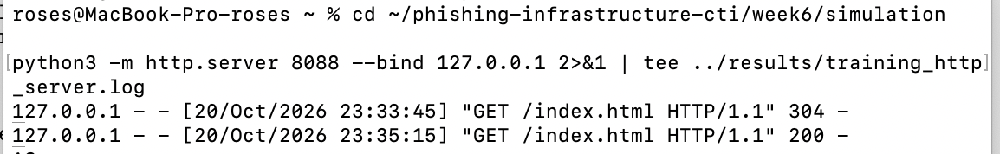
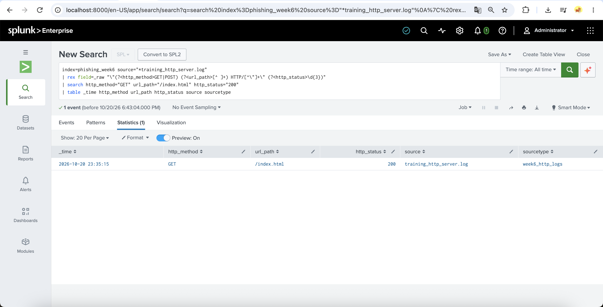

# Week 6 — MITRE ATT&CK Technique Analysis

**Project:** Cyber Threat Intelligence Analysis of Phishing Infrastructure  
**Selected technique:** T1566.002 — Phishing: Spearphishing Link  
**Tactic:** Initial Access  
**Environment:** Offline analysis of redacted email samples, local macOS HTTP demonstration, Splunk Enterprise, MITRE ATT&CK Navigator

## 1. Introduction and objective

MITRE ATT&CK organizes observed adversary behavior into tactics (objectives), techniques (methods), and procedures (specific implementations). This exercise studies **T1566.002 — Spearphishing Link**, evaluates phishing-related email artifacts, demonstrates a benign link-access event in a controlled local environment, and maps the resulting evidence to the ATT&CK framework.

**Assignment objectives:** study one technique; conduct a controlled and safe demonstration related to that technique; document evidence; and map observations to ATT&CK tactics and techniques. The demonstration is **partial**: it validates local link-access telemetry rather than reproducing the delivery of a real phishing message.

## 2. Tactics, techniques and procedures

- **Tactic — Initial Access:** the adversary's objective of gaining a foothold in a target environment.
- **Technique — T1566 Phishing:** attempts to gain access by using phishing messages.
- **Sub-technique — T1566.002 Spearphishing Link:** phishing messages include a link intended to lead a recipient toward an attacker-controlled destination or follow-on action.
- **Procedure:** the concrete message, destination, and follow-on steps used in a particular campaign. This lab does not attribute either examined email to a named threat actor or confirm a complete adversary procedure.

## 3. Real-world threat scenario and research hypothesis

A common phishing-link scenario involves an account-security or service-interruption pretext, a link embedded in an email, and an attempted recipient action. Analysts can investigate email wording, hyperlink structures, apparent destinations, and subsequent web or endpoint logs. None of these features alone proves maliciousness or compromise.

**Hypothesis H1:** two selected redacted emails will show a common hostname and characteristics consistent with a potential phishing-link lure.  
**Hypothesis H2:** Splunk can identify a successful request to a benign local page during a controlled demonstration.  
**Boundary:** H1 concerns email artifacts; H2 concerns local HTTP telemetry. A successful H2 does **not** independently prove T1566.002 occurred.

## 4. Dataset and research integrity

**Source:** [cw-l/email-corpus](https://github.com/cw-l/email-corpus), a corpus of redacted email samples intended for security research and education. Two `.eml` samples were inspected offline. Their routing details or contributor identifiers may be removed, and defanged links must not be treated as verified live indicators.

The analyst used Python email/HTML parsing to review headers and count hyperlink attributes, compare hostnames, inspect fragment/query presence, and create an aggregate CSV. A **separate reproducibility script** is now supplied as `scripts/analyze_eml.py` for independent re-analysis; it is not the historical script used to produce the original counts, and a subsequent rerun on the selected two samples is documented in Section 17. No links from these samples were opened. The CSV is derived analysis data; it is **not** the original email evidence. The underlying email content and the exact original full link paths are not included in this repository. For a reproducibility check, obtain the public redacted source samples independently and run the supplied script on the same two files; because the two original sample filenames are not pinned in this repository, exact replication of the published sample counts cannot yet be guaranteed.

## 5. Observations from two email samples

| Measurement | Email_1 | Email_2 |
|---|---:|---:|
| HTML hyperlinks | 7 | 5 |
| Unique full-link values | 7 | 5 |
| Links with URL fragments | 7 | 5 |
| Links with query strings | 0 | 0 |
| Observed defanged hostname | `storage[.]googleapis[.]com` | `storage[.]googleapis[.]com` |

The two subject lines communicated account restriction/suspension themes. Across the two samples, **12 hyperlinks** were counted. Each sample contained one unique parsed hostname in the investigated link set; both samples shared that hostname. Earlier analysis also found a matching **path-hash prefix** across the samples, which indicates a common parsed path value under that specific extraction method, not necessarily identical complete URLs.

**Interpretation:** common hosting and similar account-related pretexts justify further investigation. `storage.googleapis.com` is a legitimate cloud storage hostname and should **not** be labeled malicious solely because it appears in these messages. The original links were not visited and their destination behavior was not established.


## 6. Email infrastructure correlation in Splunk

A structured two-row CSV (`data/week6_email_analysis.csv`) was imported into Splunk index `phishing_week6`. The analyst grouped rows by shared domain to count related emails and sum their extracted hyperlink counts.

```spl
index=phishing_week6 email_id=*
| stats count AS email_count sum(html_links) AS total_links values(email_id) AS related_emails by domain
```

**Observed:** `email_count=2`, `total_links=12`; the two email IDs are associated with the same defanged hostname. This is a correlation of two manually selected samples, **not** evidence of a common attacker or an active campaign.


## 7. Controlled simulation design and validation status

**Scope:** a non-delivered, fictional training-message description and a **local-only** demonstration of a benign page visit. No impersonation of a real organization, third-party link, credential form, or outbound message is used.

The training narrative describes a fictional recipient encountering a routine account-notice message with a link to an explicitly labeled *educational* page hosted on `127.0.0.1`. The narrative provides context for the **link-in-message** component of T1566.002. This step is a *scenario description*, not a delivered phishing email; it was **not** monitored as email delivery telemetry.

An optional **explicitly labeled, local training-message mock-up** is supplied as `simulation/training_message.html`. It contains only a localhost link to the existing educational page; it is not an actual phishing email and must not be sent to recipients. To evaluate the message-to-click sequence, a student may open this mock-up locally, click the link while the local server is running, and capture a NEW corresponding server log with a unique timestamp. **A subsequent controlled local navigation test was performed and documented in Section 16. The local HTTP request was recorded, but the server log alone cannot verify the referring message**. The subsequent local navigation test is documented in Section 16 with screenshots and HTTP log evidence. The recorded HTTP requests do not independently prove their referring document.

The actual lab action already performed was a browser request to an educational `index.html` served on `127.0.0.1:8088`. The page stated that it was a local lab and collected no credentials. The server logged `GET /index.html HTTP/1.1` with status **200**, along with two 404-related log lines (one for a missing favicon). A **GET 200** confirms retrieval of the local page, not a successful phishing attempt.


The test plan and original HTML source are preserved under `simulation/`. The added `simulation/training_message.html` is a proposed educational extension only. See `simulation/validation_steps.md` for evidence collection without misrepresenting the prior HTTP log.

## 8. Splunk detection and investigation

**Ingest configuration:** index `phishing_week6`, source `http_server.log`, sourcetype `week6_http_log`. Splunk returned **three HTTP log events**.


The following verified SPL query extracts method, path, and status from Python HTTP-server log lines, then filters the recorded visit:

```spl
index=phishing_week6 sourcetype=week6_http_log
| rex field=_raw "\"(?<http_method>GET|POST) (?<url_path>[^ ]+) HTTP/[^\"]+\" (?<http_status>\d{3})"
| search http_method="GET" url_path="/index.html" http_status="200"
| table _time http_method url_path http_status source
```

**Observed result:** one match, timestamp `2026-10-20 18:02:54`, `GET`, `/index.html`, status `200`, source `http_server.log`. The saved query is in `queries/week6_http_detection.spl`.


### Detection rationale and limitations

- **Fields checked:** `_raw` supplies the original server line; `rex` extracts `http_method`, `url_path`, `http_status`; `source` identifies the input; `_time` indicates when the event was recorded.
- **Positive condition:** a GET to the known **local lab path** with HTTP 200. It detects page access, **not phishing**.
- **False positives:** any ordinary user, administrator, test client, browser refresh, or health check could request the same path and receive HTTP 200.
- **Blind spots:** no email delivery logs, sender reputation, recipient identity, browser URL context, endpoint execution, credential activity, or proof that the request originated from an email click were collected. Without these additional sources, the request cannot be linked to a delivered lure.
- **Defender next steps:** in a real authorized environment, correlate email security logs, URL click telemetry, proxy/DNS logs and endpoint events before labeling activity as phishing. Do not block a shared cloud hostname based on this lab.

## 9. ATT&CK mapping and evidentiary confidence

| Activity or observation | ATT&CK tactic | Candidate technique | Evidence | Confirmation |
|---|---|---|---|---|
| Account-restriction and suspension pretexts in two redacted emails | Initial Access (context) | T1566 Phishing | Offline email subject review | **Observed themes**; malicious intent not independently verified |
| HTML links associated with those two emails | Initial Access (context) | T1566.002 Spearphishing Link | HTML parsing: 7 + 5 links | **Observed links**; specific ATT&CK usage remains a hypothesis |
| Shared cloud-hosting hostname | Not an adversary action on its own | No independent ATT&CK assignment | Aggregate CSV and Splunk grouping | **Confirmed correlation**, not malicious hosting |
| Fictional training-message narrative and new localhost-only HTML mock-up | Initial Access (modeled context) | T1566.002 | `simulation/training_message.html` and validation plan | **Artifact prepared**, local navigation subsequently tested as described in Section 16; the HTTP logs do not independently establish the referring message |
| Local HTTP GET to `/index.html` | No proven adversary tactic | Supporting telemetry for scenario, not itself T1566.002 | Server log + Splunk SPL, HTTP 200 | **Confirmed benign page access** |
| Filtering and reviewing the HTTP event in Splunk | Defender action (not ATT&CK adversary tactic) | Not assigned | `week6_http_detection.spl` | **Confirmed defensive analysis** |

**Conclusion of mapping:** T1566.002 is an appropriate **research focus and modeled scenario**, but the laboratory does **not** demonstrate a completed real-world spearphishing attempt or compromise. See `results/week6_attack_mapping.md` for the companion evidence summary.

## 10. ATT&CK Navigator visualization

The Navigator layer marks **T1566.002** under **Initial Access**. Its color/comment indicates the scope of the investigation; it should not be interpreted as proof that a real adversary deployed the technique. File: `navigator/week6_attack_layer.json`.


## 11. Results and hypothesis evaluation

| Hypothesis | Result | Interpretation |
|---|---|---|
| H1: samples share a hostname and potentially phishing-related lures | Supported for the **two selected samples** | Shared hostname and account-related themes observed, with no attribution |
| H2: Splunk can identify a successful benign local page visit | Supported | One GET `/index.html` with HTTP 200 found among three ingested log events |
| A full T1566.002 attack was reproduced | **Not established** | No delivered message-to-click evidence or adversary behavior was recorded |

The outcome is a documented investigation of email link metadata plus a limited, instrumented, local HTTP demonstration. The offline analysis was subsequently reproduced on the two selected redacted email samples, with matching aggregate counts documented in Section 17. The mock-up represents an optional follow-up test, not completed evidence.

## 12. Security recommendations

In operational investigations, use mail-gateway and click-tracking telemetry to associate an email with a specific request; inspect sender authentication and message headers where available; correlate network and endpoint observations; and apply reputation or isolation decisions to **validated, specific indicators**, not broadly shared storage infrastructure. Consider explainable detection logic, false-positive review, and repeatable evidence retention.

## 13. Limitations, ethics, and reproducibility

The study includes only two historical redacted messages. Some metadata is deliberately removed. The training-message scenario was not delivered. The local page is harmless and no credentials were collected. The data does not establish attacker identity, user deception, malware execution, campaign prevalence, or compromise. Times are recorded as displayed in Splunk and may reflect the local timezone. A reader can reproduce the Splunk aggregation using the aggregate CSV, and can rerun the local HTTP demo using the saved SPL, HTML files, and instructions. The provided `scripts/analyze_eml.py` was subsequently executed against the two selected redacted samples, as documented in Section 17. It was not the original historical analysis script. The source dataset is identified, but the exact original sample identifiers are not pinned in this repository, so independent reproduction still requires locating the same two files.

### Reproducibility command (offline only)

Run this only on locally stored, redacted `.eml` files for which analysis is authorized. The command **does not contact any URL**:

```bash
python3 scripts/analyze_eml.py /path/to/sample1.eml /path/to/sample2.eml --output /tmp/week6_recomputed.csv
```

The two rows produced should be reviewed before comparing them to `data/week6_email_analysis.csv`; differences may arise from MIME structure, encoding, or sample selection. No original message content, sender address, or full hyperlink is written to the output.

## 14. Conclusion

This Week 6 work studies T1566.002 in the context of phishing infrastructure research, measures hyperlink metadata across two redacted email samples, correlates their hostname in Splunk, and identifies one benign local HTTP request using SPL. The separation between **observed artifacts**, **modeled technique context**, and **confirmed system events** is essential for accurate ATT&CK mapping. The labeled local-message mock-up can support a future message-to-click classroom validation, but no new activity is assumed. Further instrumented, authorized testing would be required to demonstrate more of the technique.

## 15. References

1. MITRE ATT&CK, [T1566.002 — Spearphishing Link](https://attack.mitre.org/techniques/T1566/002/).
2. MITRE ATT&CK, [T1566 — Phishing](https://attack.mitre.org/techniques/T1566/).
3. MITRE, [ATT&CK Navigator](https://mitre-attack.github.io/attack-navigator/).
4. `cw-l`, [email-corpus](https://github.com/cw-l/email-corpus).


## 16. Validated Local Training Link Demonstration

### Objective
Validate a controlled educational link-navigation scenario
associated with MITRE ATT&CK T1566.002.

### Laboratory Setup
- Environment: macOS and Python HTTP Server
- Local address: 127.0.0.1:8088
- Training message: simulation/training_message.html
- Destination: simulation/index.html
- SIEM: Splunk Enterprise
- Index: phishing_week6
- Sourcetype: week6_http_logs

### Procedure
1. Hosted a harmless educational HTML page locally.
2. Opened a training message containing a localhost link.
3. Followed the link in a browser.
4. Collected local HTTP server logs.
5. Imported the logs into Splunk.
6. Investigated the resulting HTTP events using SPL.

### Observed Results

| Time | HTTP Method | Path | Status |
|---|---|---|---|
| 23:33:45 | GET | /index.html | 304 |
| 23:35:15 | GET | /index.html | 200 |

Date: October 20, 2026.

Splunk indexed two events from training_http_server.log.
An SPL query identified one successful GET request
to /index.html with HTTP status 200.

### Evidence





### ATT&CK Interpretation
- Tactic: Initial Access
- Technique: T1566 — Phishing
- Sub-technique: T1566.002 — Spearphishing Link

The training message and local navigation demonstrate
a limited educational approximation of link-based
initial-access scenarios.

The HTTP log confirms the page request, but does not
independently establish the referring document.

This exercise did not involve real phishing delivery,
credential collection, malicious infrastructure,
or successful compromise.

## 17. Reproducibility Validation

The offline email analysis was reproduced using
the Python script `scripts/analyze_eml.py`.

Two original redacted `.eml` files from the
cw-l/email-corpus dataset were processed locally.

The script produced:
`results/week6_email_reproduced.csv`

### Reproduced Results

| Metric | Email 1 | Email 2 |
|---|---:|---:|
| HTML hyperlinks | 7 | 5 |
| Unique URL values | 7 | 5 |
| URLs with fragments | 7 | 5 |
| URLs with query parameters | 0 | 0 |

Both samples referenced the defanged hostname
`storage[.]googleapis[.]com`.

The reproduced counts match the previously documented
results in `data/week6_email_analysis.csv`.

This verifies the repeatability of the selected
email metadata analysis. It does not establish
that the shared hostname is malicious or that
the emails originated from the same attacker.

No URLs were opened during the offline analysis.
