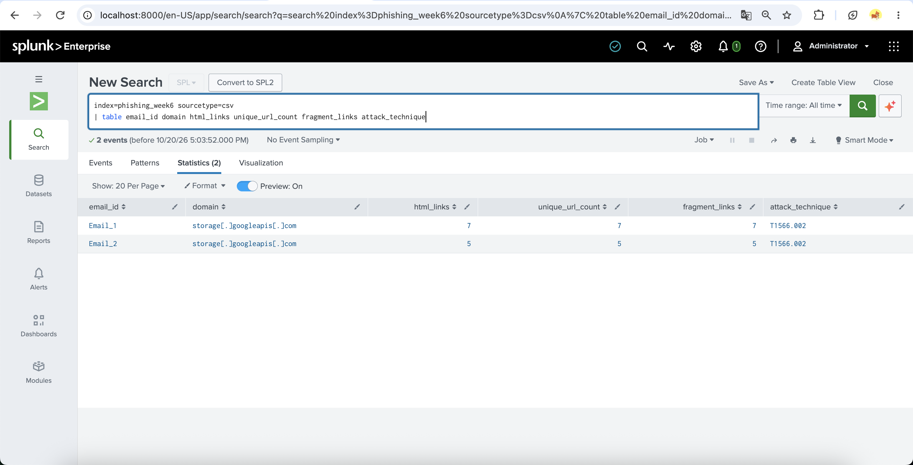
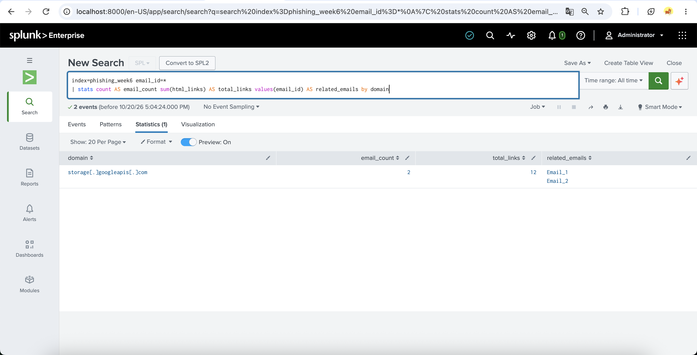
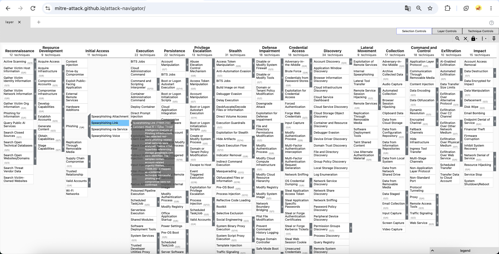
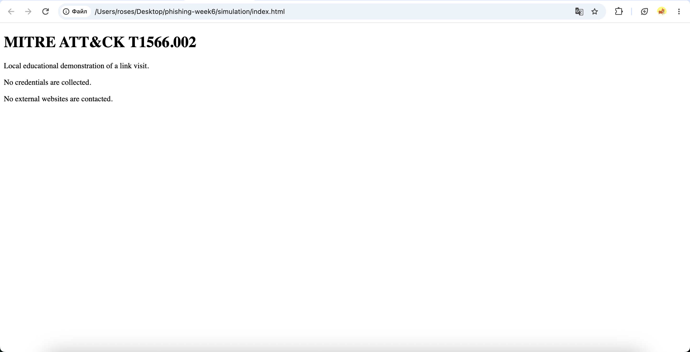
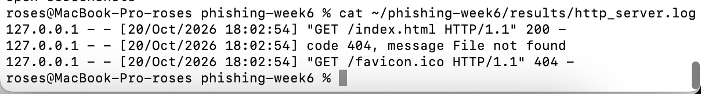
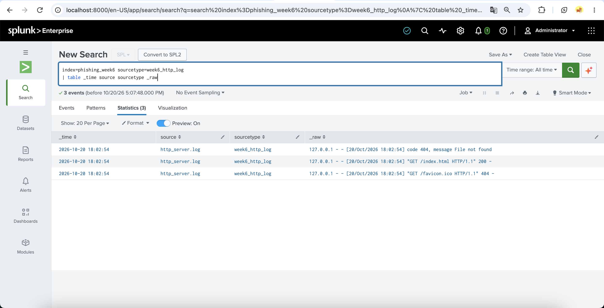
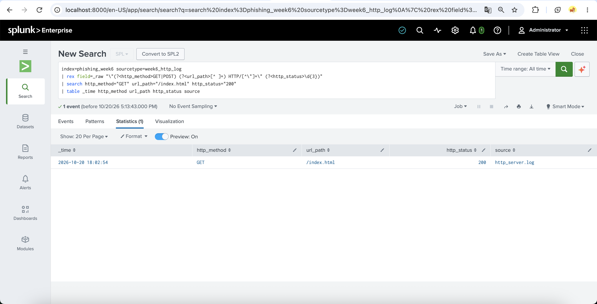

# Week 6 — MITRE ATT&CK Framework

## Project
Cyber Threat Intelligence Analysis of Phishing Infrastructure

## 1. Introduction
MITRE ATT&CK is a knowledge base of adversary tactics,
techniques, and procedures (TTPs) derived from observations
of real-world adversary behavior.

This weekly increment examines phishing-link indicators
using redacted real-world email samples and a controlled
local HTTP demonstration.

## 2. Objectives
- Explain ATT&CK tactics, techniques, and procedures.
- Study T1566.002 — Spearphishing Link.
- Analyze phishing-related email content and hyperlinks.
- Correlate common link infrastructure using Splunk.
- Record observable HTTP activity in a local laboratory.
- Map findings to MITRE ATT&CK.
- Document evidence and limitations.

## 3. ATT&CK Technique Analysis
A tactic describes an adversary's objective.
A technique describes how that objective may be achieved.
A procedure is a specific implementation of a technique.

Selected technique:
- Tactic: Initial Access
- Technique: T1566 — Phishing
- Sub-technique: T1566.002 — Spearphishing Link

Spearphishing Link involves using links in targeted
phishing messages to support an initial-access attempt.

Official reference:
https://attack.mitre.org/techniques/T1566/002/

## 4. Dataset and Methodology
Source: https://github.com/cw-l/email-corpus

The source repository contains redacted real-world
phishing-related email samples. Two samples were selected
and examined offline.

The analysis considered:
- Email subject and account-related urgency themes
- HTML hyperlink counts
- Unique hyperlink counts
- Shared hostnames
- URL fragments and query parameters

URLs were not visited and were not used as live
threat intelligence indicators.

## 5. Email Analysis Results

| Metric | Email 1 | Email 2 |
|---|---:|---:|
| HTML hyperlinks | 7 | 5 |
| Unique full URLs | 7 | 5 |
| URLs with fragments | 7 | 5 |
| URLs with query parameters | 0 | 0 |

Both messages referenced the defanged hostname
`storage[.]googleapis[.]com`.

The shared hostname alone does not establish malicious
infrastructure or attribution to the same attacker.

## 6. Infrastructure Correlation
Two examined emails contained a combined total of
12 HTML hyperlinks referencing the same hostname.

This provides an observable correlation between
the selected samples, but does not establish
that the hostname itself is malicious.

## 7. ATT&CK Navigator
A Navigator layer was created to highlight
T1566.002 under the Initial Access tactic.

File: `navigator/week6_attack_layer.json`

The technique mapping is a research hypothesis,
not proof of a successful intrusion.

## 8. Controlled Laboratory Demonstration
A harmless educational page was hosted locally
using Python's HTTP server on `127.0.0.1:8088`.

The browser requested `/index.html`, and the
server returned HTTP status 200.

No external websites were visited during the
local demonstration.

## 9. Splunk Log Investigation
The local HTTP log was imported into Splunk.

Configuration:
- Index: `phishing_week6`
- Sourcetype: `week6_http_log`
- Source: `http_server.log`

Three log entries were observed, including one
successful request to `/index.html` and a
404 response for `/favicon.ico`.

The detection query is available in:
`queries/week6_http_detection.spl`

The query extracted the HTTP method, path, and
status code and identified one successful
GET request to `/index.html`.

## 10. ATT&CK Mapping

| Activity | ATT&CK association | Evidence |
|---|---|---|
| Account-related urgency themes | Potential T1566 phishing context | Two redacted email samples |
| HTML links in phishing-related emails | Candidate T1566.002 | Offline email analysis |
| Shared hosting domain | Infrastructure correlation, not a separate ATT&CK technique | 12 observed hyperlinks |
| Local GET /index.html | Benign link-access demonstration | HTTP status 200 in Splunk |

The local HTTP request does not by itself demonstrate
delivery of a phishing message or adversary initial access.

Detailed mapping:
`results/week6_attack_mapping.md`

## 11. Results and Findings
The investigation produced:
- Two analyzed real-world redacted email samples.
- Twelve HTML hyperlinks across the samples.
- One shared hostname.
- One ATT&CK Navigator layer.
- A controlled local HTTP demonstration.
- Three HTTP log entries indexed in Splunk.
- One successful HTTP request identified by SPL.

The results demonstrate a repeatable process for
collecting and investigating phishing-related evidence.

## 12. Limitations
The selected dataset is small and does not support
general conclusions about phishing campaigns.

The email samples are historical and redacted.
The hosting domain is not a verified malicious IOC.

No phishing email was sent during the local exercise.
No credentials were collected.
No compromise or successful initial access was observed.

The local HTTP activity is not a complete simulation
of an adversary executing T1566.002.

## 13. Conclusion
This weekly increment applied MITRE ATT&CK to a
phishing infrastructure research topic.

Redacted real-world emails provided phishing-related
observations, while Splunk supported correlation and
investigation of recorded events.

The work also demonstrated the distinction between
potential ATT&CK mappings and confirmed attack activity.

## 14. References
- MITRE ATT&CK T1566.002:
  https://attack.mitre.org/techniques/T1566/002/
- MITRE ATT&CK T1566:
  https://attack.mitre.org/techniques/T1566/
- ATT&CK Navigator:
  https://mitre-attack.github.io/attack-navigator/
- Email corpus:
  https://github.com/cw-l/email-corpus
