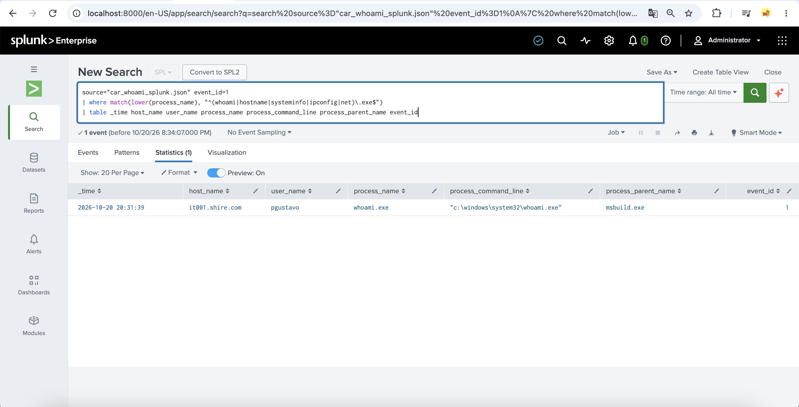
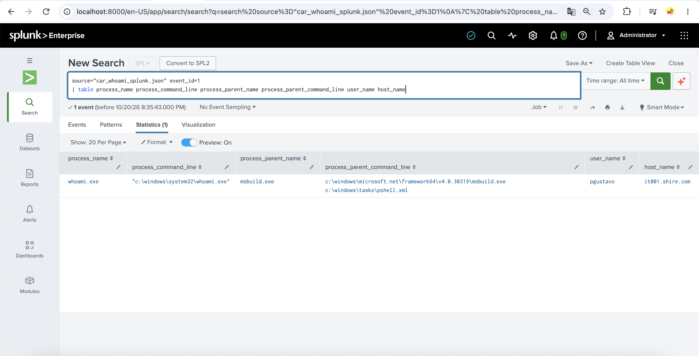
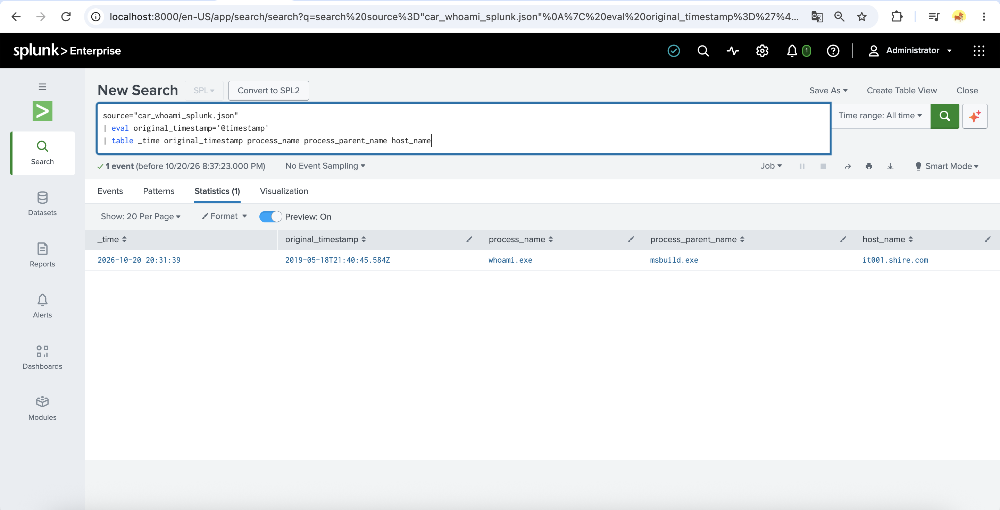
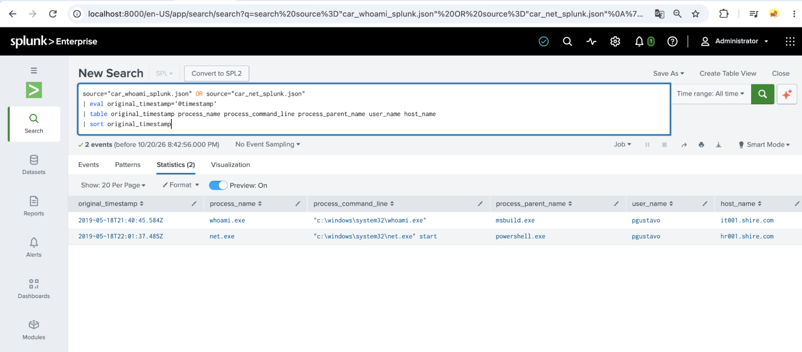
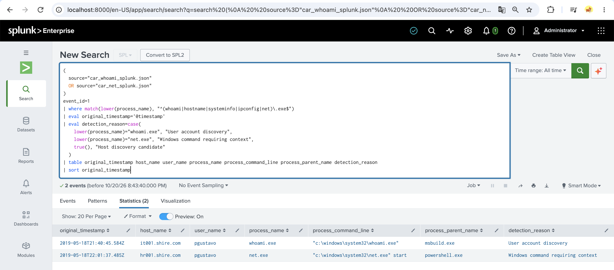
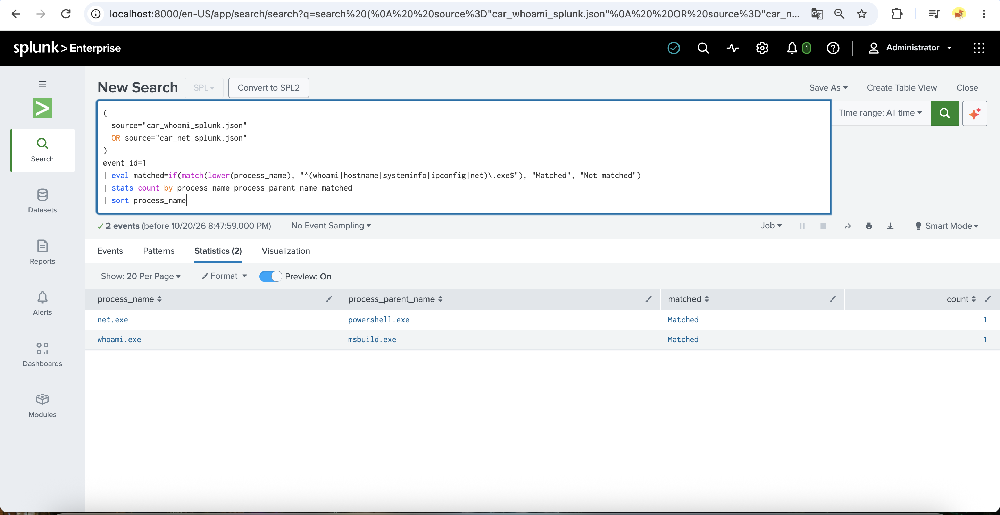

# Week 7 — Using MITRE CAR (Cyber Analytics Repository)

## 1. Introduction

This laboratory exercise explores how a detection analytic from the MITRE Cyber Analytics Repository (CAR) can be implemented and evaluated in a Security Information and Event Management (SIEM) platform.

The selected analytic is CAR-2016-03-001 — Host Discovery Commands.

The implementation uses Splunk Enterprise to investigate publicly available recorded Windows Sysmon process creation events. No fabricated security events were used.

## 2. Objectives

- Study an official MITRE CAR analytic.
- Understand the difference between analytics and detections.
- Implement adapted detection logic in Splunk.
- Analyze recorded process creation events.
- Map observed behavior to MITRE ATT&CK.
- Document evidence, limitations, and findings.

## 3. Selected MITRE CAR Analytic

Analytic ID: CAR-2016-03-001

Name: Host Discovery Commands

Official reference:
https://car.mitre.org/analytics/CAR-2016-03-001/

This analytic concerns the execution of commands that may reveal information about a host, its users, or its configuration.

Discovery commands are commonly used for legitimate administration and troubleshooting. Their execution alone does not establish malicious intent.

## 4. Analytics vs. Detections

An analytic describes the behavioral logic used to recognize potentially relevant activity.

A detection is an implemented rule or query that applies this logic to available security telemetry.

In this exercise, the MITRE CAR analytic provides the behavioral concept, while the SPL query implements a simplified detection using recorded Sysmon process creation events.

The implementation is an adaptation and does not reproduce every condition of the original MITRE CAR analytic.

## 5. Environment and Tools

- Operating system: macOS
- SIEM: Splunk Enterprise
- Query language: Splunk Search Processing Language (SPL)
- Event source: Publicly available recorded Windows Sysmon events
- Documentation framework: MITRE CAR and MITRE ATT&CK
- Version control: Git and GitHub

Although Splunk was operated on macOS, the investigated events originated from Windows systems.

## 6. Dataset and Provenance

Two recorded events were obtained from the MITRE CAR true-positive examples associated with CAR-2016-03-001.

Original files:
- data/car_host_discovery_whoami.json
- data/car_host_discovery_net.json

The records were originally stored in an Elasticsearch-style structure, with event information under the `_source` field.

For Splunk ingestion, the `_source` objects were extracted into separate JSON files without changing their event field values.

Prepared files:
- data/car_whoami_splunk.json
- data/car_net_splunk.json

Source references:
https://car.mitre.org/true_positives/CAR-2016-03-001-mordor-02.json
https://car.mitre.org/true_positives/CAR-2016-03-001-mordor-01.json

The prepared files are derived from the original published records and are not independently collected live endpoint events.

## 7. Methodology

1. Selected the CAR-2016-03-001 analytic.
2. Downloaded two published event records.
3. Validated the JSON structure.
4. Inspected process names, command lines, parent processes, and event identifiers.
5. Extracted the original `_source` event objects.
6. Uploaded both records into Splunk Enterprise.
7. Verified successful field extraction.
8. Developed and executed an adapted SPL detection query.
9. Compared the two observed results.
10. Documented the associated ATT&CK techniques and detection limitations.

## 8. Detection Implementation

Main query:
`queries/car_host_discovery.spl`

Validation query:
`queries/car_detection_validation.spl`

The detection searches selected Sysmon Event ID 1 process creation records.

It identifies process names matching a predefined list of Windows commands, including whoami.exe and net.exe.

The SPL query also extracts the original event timestamp and includes the process name, command line, parent process, username, and hostname in the results.

This is a simplified command-name-based detection and requires additional context for production use.

## 9. Observed Results

Two published records were processed successfully.

| Event | Process | Parent Process | Host |
|---|---|---|---|
| 1 | whoami.exe | msbuild.exe | it001.shire.com |
| 2 | net.exe start | powershell.exe | hr001.shire.com |

Both records matched the implemented SPL query.

The original events were recorded on May 18, 2019.

During ingestion in October 2026, Splunk assigned new `_time` values. The original timestamps remained available in the `@timestamp` event field.

## 10. MITRE ATT&CK Mapping

| Observed Activity | Tactic | Technique |
|---|---|---|
| whoami.exe | Discovery | T1033 — System Owner/User Discovery |
| net.exe start | Discovery | T1007 — System Service Discovery |

The first event shows execution of a command used to identify the current user.

The second event shows a command that can enumerate running Windows services.

The parent processes provide additional investigative context, but neither event independently proves a successful attack.

Detailed mapping:
`results/week7_attack_mapping.md`

## 11. Detection Validation

The detection query returned two matching events.

The validation query confirmed that both available process names satisfied the selected matching condition.

Observed result:
- Recorded events evaluated: 2
- Events matching the rule: 2

These results demonstrate functionality on the two published positive examples only.

## 12. Limitations

The evaluation dataset contains only two positive examples.

No independent negative event dataset was tested. Therefore, the false-positive rate, false-negative rate, precision, recall, and overall detection accuracy cannot be reliably determined.

The rule primarily uses process names and does not establish whether the command execution was authorized or malicious.

The test data originated from Windows systems, while Splunk was operated on macOS.

The original event timestamps were preserved, but Splunk assigned ingestion-time `_time` values during upload.

No live attack or current endpoint compromise was demonstrated.

## 13. Security Recommendations

Security analysts should correlate discovery commands with:

- Parent and child process relationships.
- Command-line arguments.
- User identities and privilege levels.
- Related PowerShell and script execution.
- Other endpoint security events.
- Known administrative activity.

Detection rules should also be evaluated against independent benign and malicious datasets before production deployment.

## 14. Conclusion

This exercise demonstrates how an official MITRE CAR analytic can guide the development of a practical SIEM detection.

CAR-2016-03-001 was studied and adapted into SPL queries in Splunk Enterprise.

Two original published Sysmon process creation records were imported, analyzed, and matched by the implemented detection logic.

The observed activity was mapped to MITRE ATT&CK techniques T1033 and T1007.

The exercise demonstrates the implementation process and its limitations. Further evaluation with a larger and more diverse dataset is required to assess detection quality.

## 15. References

1. MITRE CAR — Host Discovery Commands:
   https://car.mitre.org/analytics/CAR-2016-03-001/

2. MITRE ATT&CK — T1033:
   https://attack.mitre.org/techniques/T1033/

3. MITRE ATT&CK — T1007:
   https://attack.mitre.org/techniques/T1007/

4. Splunk Documentation:
   https://docs.splunk.com/

## 16. Evidence and Screenshots

The following screenshots document the implementation and validation of the MITRE CAR analytic in Splunk Enterprise.

### Screenshot 1 — Initial CAR Detection

The first SPL query identified the recorded whoami.exe process creation event.

### Screenshot 2 — Parent Process Analysis

The analysis confirmed that whoami.exe was launched by msbuild.exe.

### Screenshot 3 — Timestamp Validation

The original 2019 timestamp was compared with the timestamp assigned by Splunk during ingestion.

### Screenshot 4 — Original Recorded Events

Two published Sysmon records were successfully imported into Splunk.

### Screenshot 5 — Combined Detection

The adapted SPL detection returned two matching records.

### Screenshot 6 — Detection Validation

Both available process creation events matched the implemented command-name detection condition.

## 17. Reproducibility

The repository includes the original recorded event files, the extracted JSON event objects used for Splunk ingestion, the SPL queries, and the documented detection results.

The queries are limited to the selected published events and can be reproduced by importing the prepared JSON files into Splunk Enterprise with sourcetype `_json` and selecting the All time search range.

The original `@timestamp` field should be used to interpret event chronology.

The evaluation demonstrates rule functionality on two positive examples, not production detection accuracy.

## 18. Comparison with the Original MITRE CAR Analytic

The implemented SPL rule was compared against the official
CAR-2016-03-001 Host Discovery Commands analytic.

| Feature | Official CAR | Implemented SPL |
|---|---|---|
| Data source | Process creation | Sysmon Event ID 1 |
| Command coverage | Multiple built-in Windows discovery commands | Five selected command names |
| Command-line filtering | Special handling for sc query/qc | Not implemented |
| Parent process context | Recommended for investigation | Included in output |
| Allowlisting and anomaly analysis | Recommended for tuning | Not implemented |
| Evaluation dataset | General analytic definition | Two published examples |

### Implementation Differences

The original MITRE CAR analytic includes commands such as
quser, qwinsta, tasklist, and sc with selected arguments.

The implemented SPL rule does not cover these commands.

The current rule matches selected process names and does
not use parent-process conditions to determine whether
a command execution is suspicious.

### Validation Scope

The implementation matched both selected published events:
- whoami.exe
- net.exe start

This demonstrates basic functionality on two positive
examples. It does not establish detection accuracy,
precision, recall, or production readiness.

### Future Improvements

- Extend command coverage to match the official analytic.
- Add command-line conditions where appropriate.
- Incorporate parent-process context into investigations.
- Test against independent benign and malicious records.
- Evaluate false positives and false negatives.
- Introduce environment-specific tuning.

Official reference:
https://car.mitre.org/analytics/CAR-2016-03-001/
