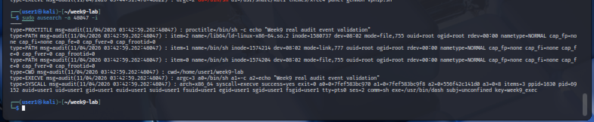
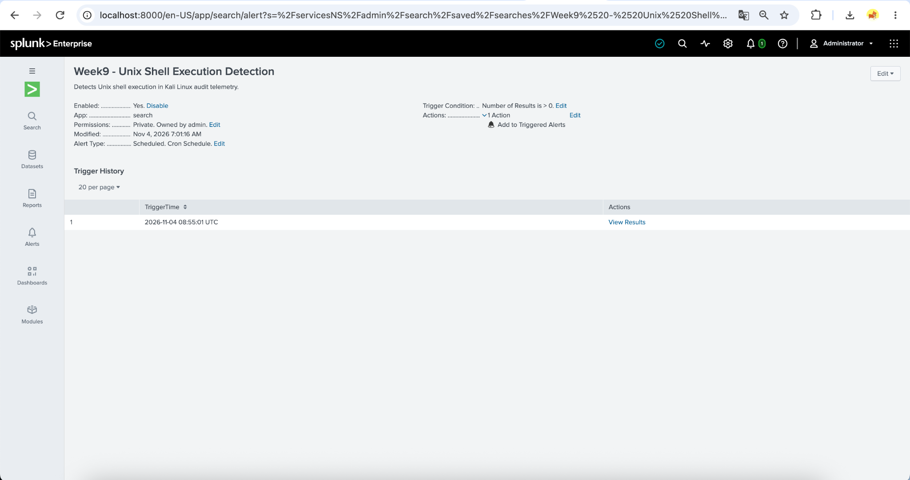
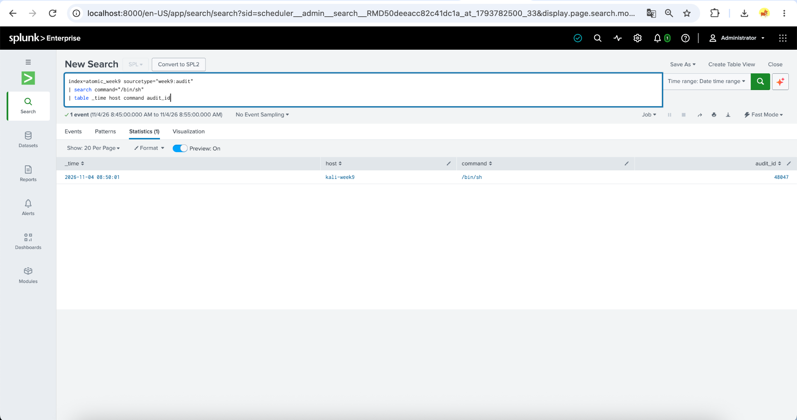

# Week 9 — Atomic Red Team: Phishing-Related Technique Simulation and SIEM Analysis

## 1. Introduction


This week focuses on Atomic Red Team, an open-source framework developed by Red Canary for testing security detection capabilities using techniques mapped to MITRE ATT&CK.

Our group project, **Cyber Threat Intelligence Analysis of Phishing Infrastructure**, investigates indicators and activities associated with phishing campaigns.

For Week 9, we performed two safe, adapted Atomic Red Team tests in an isolated Kali Linux virtual machine and analyzed the recorded events using Splunk Enterprise.

During Week 9, we tested how security monitoring can record specific activities in Linux. We performed two safe, adapted Atomic Red Team tests and analyzed the resulting events in Splunk.

## 2. Objectives


- Understand the purpose of Atomic Red Team.
- Perform safe tests mapped to MITRE ATT&CK.
- Collect Linux process execution events using Auditd.
- Forward selected events to Splunk SIEM.
- Develop SPL queries to identify the test activities.
- Evaluate telemetry visibility and detection limitations.

Our goal was to execute test actions, record them with Auditd, manually forward selected events to Splunk, and verify that SPL searches could retrieve them.

## 3. Laboratory Environment


| Component | Configuration |
|---|---|
| Host OS | macOS Sequoia |
| Virtualization | UTM |
| Test Machine | Kali Linux 2025.1 |
| Architecture | x86_64 |
| Test reference | Atomic Red Team YAML definitions (manually adapted; no Invoke-AtomicRedTeam runner used) |
| Logging | Linux Audit (auditd) |
| SIEM | Splunk Enterprise 10.6.0.5 (build `86587d4e3b27`), Docker container `splunk-week5` |
| Containerization | Docker |
| Data Transfer | HTTP Event Collector (HEC) |
| Splunk Index | `atomic_week9` |

We used Kali Linux in a UTM virtual machine and ran Splunk Enterprise in Docker on a Mac. Auditd recorded process execution, and HEC allowed us to manually forward selected events to Splunk.

## 4. Methodology


The experiment followed these steps:

1. Prepared Kali Linux and Splunk Enterprise.
2. Installed and configured Linux Audit.
3. Enabled monitoring of process execution events.
4. Reviewed the [T1059.004 YAML](https://github.com/redcanaryco/atomic-red-team/blob/master/atomics/T1059.004/T1059.004.yaml) and [T1082 YAML](https://github.com/redcanaryco/atomic-red-team/blob/master/atomics/T1082/T1082.yaml) test definitions.
5. Manually executed two harmless adaptations of the documented procedures. `Invoke-AtomicRedTeam` was not used.
6. Extracted relevant audit events.
7. Forwarded selected, sanitized events to Splunk through HEC.
8. Analyzed the results with SPL queries.

The experiments were conducted in a controlled educational environment without malicious payloads or credential extraction.

First, we prepared the lab and configured Auditd. We then reviewed the Atomic Red Team YAML definitions, manually ran two harmless adapted tests, inspected the audit records, and analyzed selected events in Splunk.

## 5. Executed Tests

We tested two MITRE ATT&CK techniques: Unix shell execution and system information discovery. These were isolated benign procedures, not a full phishing attack.

### 5.1 T1059.004 — Command and Scripting Interpreter: Unix Shell


**Atomic Test #1: Create and Execute Bash Shell Script**

**Objective:** Demonstrate shell script execution and verify process execution logging.

A simple shell script was created to display a message and perform a local connectivity check using `127.0.0.1`.

The shell-script procedure was manually adapted from [Atomic Red Team T1059.004 Test #1](https://github.com/redcanaryco/atomic-red-team/blob/master/atomics/T1059.004/T1059.004.yaml). Its test content was simplified to a benign local loopback check.

**Observed results:**

- The shell script executed successfully.
- The connectivity check completed with four successful responses.
- Linux Audit recorded an `EXECVE` event for the shell execution.
- One selected event was forwarded to Splunk.

**SIEM result:** The execution event was successfully retrieved using an SPL search.

For the first test, we ran a simple shell script that checked connectivity to the local address 127.0.0.1. Auditd recorded its execution, and we successfully retrieved one selected event in Splunk.

### 5.2 T1082 — System Information Discovery


**Atomic Test #3: List OS Information**

**Objective:** Demonstrate system information discovery and verify logging of the related commands.

The following commands were executed:

- `uname -a`
- `cat /etc/os-release`
- `uptime`

The commands collected operating system information, kernel information, and system uptime. They were manually adapted from [Atomic Red Team T1082 Test #3](https://github.com/redcanaryco/atomic-red-team/blob/master/atomics/T1082/T1082.yaml), not executed with an automated test runner.

**Observed results:**

- System information was successfully collected.
- Linux Audit recorded process execution activity.
- Two selected events, corresponding to `uname` and `uptime`, were forwarded to Splunk.

**SIEM result:** Both events were successfully retrieved using SPL.

For the second test, we ran uname, cat /etc/os-release, and uptime to gather Linux system information. We manually forwarded two selected events for uname and uptime and found both in Splunk.

### 5.3 Cleanup


After completing the Atomic Red Team experiments, the temporary `art.sh` shell script was removed from the Kali Linux test environment.

The test output files and screenshots were retained as evidence.

No persistent system modifications or malicious payloads were introduced by the two adapted test procedures.

After completing the tests, we removed the temporary art.sh script. We kept screenshots and test results as evidence of our laboratory work.

## 6. MITRE ATT&CK Mapping


| ATT&CK ID | Technique | Tactic | Relevance to Phishing |
|---|---|---|---|
| T1059.004 | Unix Shell | Execution | Shell commands may be executed after a successful phishing compromise |
| T1082 | System Information Discovery | Discovery | Attackers may collect system information after obtaining access |

The tests do not reproduce a complete phishing attack. They demonstrate post-access behaviors that can be relevant when investigating phishing-related incidents.

We mapped our tests to MITRE ATT&CK: T1059.004 describes Unix shell execution, while T1082 describes system information discovery. This gives us a consistent way to describe observed behaviors.

### 6.1 Connection to Phishing Infrastructure CTI


Our project focuses on identifying and analyzing indicators of compromise (IOCs) associated with phishing infrastructure, including suspicious domains, URLs, and network activity.

Threat intelligence can help identify potentially malicious infrastructure, while endpoint telemetry provides additional context about activities occurring on affected systems.

For example, after investigating a suspicious phishing-related URL, a security analyst may examine endpoint logs for unusual command execution or system discovery activity.

The Week 9 tests demonstrate two types of post-access behavior: Unix shell execution (T1059.004) and system information discovery (T1082).

By combining phishing-related IOCs with endpoint logs in a SIEM, analysts can develop more informed threat hunting hypotheses.

These laboratory tests did not establish a direct connection between the simulated commands and any real phishing campaign. However, Mandiant's [2022 analysis of APT29 phishing campaigns](https://cloud.google.com/blog/topics/threat-intelligence/tracking-apt29-phishing-campaigns/) lists **T1082** and **T1003.008** among its reported ATT&CK TTPs. This provides a literature-level connection to the executed T1082 test and the theoretical T1003.008 discussion, **not** proof that the lab reproduced APT29 commands, infrastructure, or activity.

Our project focuses on phishing infrastructure, including suspicious domains and URLs. Endpoint execution logs can complement this threat intelligence by showing what happened on a device following potentially suspicious activity.

## 7. SIEM Detection Analysis


Linux Audit was configured to collect process execution events using the `execve` system call.

Selected events were processed and forwarded through Splunk HTTP Event Collector to the `atomic_week9` index. The `week9:atomic` sourcetype stores selected, manually structured test results; `week9:audit` stores selected audit-like telemetry and the separate control event used for scheduled alert validation. These are not evidence of continuous raw Auditd forwarding.

We configured Auditd to record process execution through execve. We then manually forwarded three selected events through HEC into the atomic_week9 index and verified them using Splunk searches.

### Detection Summary

| Technique | Executed | Audit Logs | Splunk Events | Result |
|---|---|---|---:|---|
| T1059.004 | Yes | Observed | 1 | Visible |
| T1082 | Yes | Observed | 2 | Visible |
| **Total** | **2 tests** | **Observed** | **3 selected** | **All 3 manually forwarded events retrieved** |

Both selected tests generated observable telemetry.

These Week 9 atomic-test results demonstrate retrieval of manually forwarded events, not automated forwarding or broad threat detection. A scheduled alert was first validated with a synthetic control event and subsequently with a separately generated, real Auditd event manually forwarded through HEC (Section 10).

### 7.1 Linux Audit Configuration


Linux Audit (auditd) was configured in Kali Linux to monitor process execution through the `execve` system call.

The following audit rule was used during the experiment:

```bash
sudo auditctl -a always,exit -F arch=b64 -S execve -F auid=$(id -u) -k week9_exec
```

The rule records process execution events associated with the test user's audit identity.

Relevant audit events were inspected using:

```bash
sudo ausearch -k week9_exec -i
```

The rule was configured for the laboratory session. It was not documented as a persistent audit rule across system reboots. The `auid` filter targets the current logged-in user's audit identity and relies on a valid Linux `loginuid`; if no events appear, inspect the audit session/login UID configuration before drawing conclusions.

This section shows the Auditd rule for monitoring execve and the ausearch command used to inspect audit records. The records provide evidence that the test programs actually ran on Kali Linux.

### 7.2 Splunk Detection Queries


**Query 1 — T1059.004 Unix Shell**

```spl
index=atomic_week9 sourcetype="week9:atomic" technique="T1059.004"
| table _time host technique command script audit_id status
```

**Query 2 — T1082 System Information Discovery**

```spl
index=atomic_week9 sourcetype="week9:atomic" technique="T1082"
| table _time host technique command audit_id status
```

**Query 3 — Detection Summary**

```spl
index=atomic_week9 sourcetype="week9:atomic"
| stats count AS events values(command) AS commands BY technique test
| sort technique
```

**Query 4 — Scheduled Unix Shell Alert**

```spl
index=atomic_week9 sourcetype="week9:audit"
| search command="/bin/sh"
| table _time host command audit_id
```

The scheduled alert ran every five minutes and searched the preceding ten minutes of indexed events.

The alert was first validated using a separate synthetic event transmitted through Splunk HEC. On November 4, a second validation used a newly generated **real Kali Auditd** event (Audit ID `48047`) that was manually extracted and forwarded via HEC.

**Interpretation:** The searches confirm successful ingestion and retrieval of selected events. Because the original Auditd events were manually forwarded, these results do not establish continuous telemetry collection or comprehensive detection coverage.

We wrote SPL queries to find events for both techniques, summarize the results, and search for /bin/sh execution. The queries displayed the selected records in Splunk tables.

## 8. Limitations


- Only two safe, manually adapted Atomic Red Team tests were executed.
- The experiments were performed in an isolated Kali Linux virtual machine.
- Selected Linux Audit events were manually extracted, sanitized, and forwarded to Splunk HEC. Therefore, the results validate the selected-event ingestion pipeline rather than continuous or comprehensive detection coverage.
- The scheduled Splunk alert was verified twice: initially on a synthetic control event, and later on **one real Auditd event** with Audit ID `48047` that was **manually** forwarded via HEC. This does not demonstrate continuous or automated Auditd log forwarding.
- The alert condition `command="/bin/sh"` is narrow and may miss other shell executable paths, including `/bin/bash` and `/usr/bin/sh`.
- The three selected Atomic Test events were visible in Splunk, but this does not establish a general detection rate.
- The tests did not reproduce a complete phishing attack.
- Original Auditd execution timestamps and Splunk ingestion timestamps were not identical.
- T1003 was analyzed theoretically; no credential dumping was performed.

Our lab tested only two isolated procedures, and event forwarding was manual. We did not validate continuous log collection or demonstrate detection of all types of attacks.

## 9. Experimental Evidence


The following screenshots document the execution of the adapted Atomic Red Team tests and the analysis of their events in Splunk SIEM.

These screenshots show the test execution in Kali Linux and the corresponding records in Splunk. They support our laboratory findings, not detection of a real phishing campaign.

### Test 1 — T1059.004: Unix Shell

**Test execution in Kali Linux:**


**Event received in Splunk:**


**SPL detection query results:**


### Test 2 — T1082: System Information Discovery

**Test execution and Linux Audit events:**


**Events received in Splunk:**


### Overall Detection Summary


Both selected tests generated Linux Audit process telemetry that was manually selected and transferred to Splunk. The additional scheduled alert validations, including the later real Auditd event, are documented in Section 10.

## 10. Automated Detection Alert Validation


An additional scheduled alert was configured in Splunk Enterprise to monitor Unix shell execution events.

**Alert configuration:**

- Alert name: Week9 - Unix Shell Execution Detection
- Search index: `atomic_week9`
- Sourcetype: `week9:audit`
- Detection condition: `command="/bin/sh"`
- Schedule: Every 5 minutes
- Search window: Last 10 minutes
- Trigger condition: Number of Results greater than 0
- Action: Add to Triggered Alerts
- Severity: Medium

**Validation A — synthetic control event:** A synthetic validation event was submitted through Splunk HEC to test the alert.

**Observed results:**

- The validation event was successfully indexed.
- The scheduled search matched one event.
- Splunk recorded one automatic alert trigger on November 4, 2026, at 07:10 UTC.
- The matching event was visible through the View Results page.

We configured a scheduled alert to search for /bin/sh executions every five minutes over a ten-minute window. We first validated it using a synthetic event and then using a genuine Auditd event that was manually forwarded.

### 10.1 Additional validation — real Auditd event (November 4, 2026)


A separate harmless Kali Linux command, `/bin/sh -c 'echo "Week9 real audit event validation"'`, generated a genuine `EXECVE` record in Linux Audit with **Audit ID `48047`** and audit key `week9_exec`. Using `ausearch -a 48047 -i`, the team verified the raw `EXECVE`, `SYSCALL` and associated records. The event was then **manually** transformed into HEC JSON while retaining the original audit record in `audit_raw`, with fields `command=/bin/sh`, `audit_id=48047` and `validation_type=real_audit_manual_forward`.

Splunk HEC returned `{"text":"Success","code":0}`. The event was indexed under `index=atomic_week9` and `sourcetype=week9:audit`; an independent search retrieved **one** matching event. The scheduled search at **08:50 UTC** ran before ingestion and reported zero results; its next run at **08:55:01 UTC** returned `result_count=1`. The alert's Trigger History recorded a firing at **08:55:01 UTC**, and **View Results** contained the matching `host=kali-week9`, `command=/bin/sh`, `audit_id=48047` entry.

**Interpretation:** This verifies that the configured scheduled Splunk alert can match and fire on a **real, manually forwarded Auditd event**, as well as on synthetic test data. It does **not** demonstrate automatic or continuous forwarding from Kali, detection of malicious activity, or detection of an actual phishing attack.

**Conclusion:** Rule execution, scheduled triggering, and the manually forwarded real-event path were verified in this educational environment. The original two Atomic Red Team adaptations remain separate from this later validation.

For the additional validation, we generated a harmless Auditd event with ID 48047 and manually sent it to Splunk. At 08:55:01 UTC, the scheduled search found the record and triggered the alert.

### Alert Evidence


**Additional genuine Auditd event evidence:**







## 11. Additional MITRE ATT&CK Analysis — T1003


**Technique:** T1003 — OS Credential Dumping  
**Tactic:** Credential Access  
**Analysis type:** Theoretical (not executed)

We also reviewed T1003, which concerns credential access, at a theoretical level. We did not run any password or credential extraction procedures.

### Linux-Specific Subtechniques

**T1003.007 — Proc Filesystem**

This subtechnique concerns attempts to obtain credential-related information through the Linux `/proc` filesystem.

**T1003.008 — /etc/passwd and /etc/shadow**

This subtechnique concerns attempts to access Linux account information and password hash storage files.

### Relevance to Our Laboratory

Our Kali Linux environment uses Linux Audit to monitor process execution. However, the current `execve` monitoring rule does not provide comprehensive visibility into file access or credential-related activity.

Additional, appropriately configured file-access auditing would be required to investigate suspicious access to sensitive authentication resources.

Both subtechniques were analyzed theoretically. No credential extraction or password hash collection was performed. T1003 concerns credential access after compromise; it is relevant to interpreting potential post-phishing activity, but it was not tested in this laboratory.

### Potential Detection Indicators

- Unusual access to credential-related operating system resources.
- Suspicious process activity involving sensitive authentication components.
- Unexpected access attempts by unauthorized accounts.
- Security monitoring alerts related to credential access.

### Monitoring Recommendations

Organizations should collect relevant operating system security logs, monitor access to sensitive resources, apply least-privilege access controls, and investigate suspicious credential-related activity.

### Experiment Scope

The practical experiments remained focused on T1059.004 and T1082. No credential dumping commands or access to authentication secrets were performed.

## 12. Conclusion


Week 9 demonstrated how safe, manually adapted Atomic Red Team procedures can support security monitoring and threat hunting.

Two techniques, T1059.004 (Unix Shell) and T1082 (System Information Discovery), were successfully executed in Kali Linux. Linux Audit recorded the corresponding process execution activity, and three selected events were manually forwarded to Splunk Enterprise.

The experiment confirmed that selected Auditd events could be transferred, indexed, and analyzed using SPL queries. However, this represents validation of the manual event ingestion pipeline rather than comprehensive or continuous detection coverage.

A scheduled Splunk detection alert was configured and successfully triggered using an initial synthetic control event and, in a separate validation, a genuine Auditd event (Audit ID `48047`) manually forwarded through HEC. The real event was matched by the scheduled search, and the alert fired at 08:55:01 UTC. This did not establish continuous automatic Auditd collection or detection of malicious activity.

Additionally, T1003 (OS Credential Dumping) was reviewed theoretically to identify relevant credential-access risks and potential monitoring opportunities. No credential dumping was performed.

These results demonstrate how endpoint telemetry, SIEM analysis, and MITRE ATT&CK mapping can support investigations of suspicious post-compromise activity associated with phishing incidents.

Future improvements include automated Auditd log forwarding, broader shell execution detection rules, and assessing noisy legitimate `/bin/sh` activity to reduce false positives.

In summary, we completed two safe tests, retrieved three selected events in Splunk, and validated a scheduled alert using a genuine Auditd record. Future work should automate log collection and improve detection rules.

## 13. References


1. Red Canary — Atomic Red Team: https://github.com/redcanaryco/atomic-red-team
2. MITRE ATT&CK — T1059.004: https://attack.mitre.org/techniques/T1059/004/
3. MITRE ATT&CK — T1082: https://attack.mitre.org/techniques/T1082/
4. Red Canary — Atomic Red Team Wiki: https://github.com/redcanaryco/atomic-red-team/wiki
5. Official T1059.004 test YAML: https://github.com/redcanaryco/atomic-red-team/blob/master/atomics/T1059.004/T1059.004.yaml
6. Official T1082 test YAML: https://github.com/redcanaryco/atomic-red-team/blob/master/atomics/T1082/T1082.yaml
7. Splunk Documentation: https://docs.splunk.com/

We relied on official Red Canary, MITRE ATT&CK, and Splunk documentation to prepare the laboratory and verify the technique descriptions.

## 14. Use of AI


ChatGPT (OpenAI) was used during the Week 9 laboratory and reporting workflow.

| Task | Tool | Verification |
|---|---|---|
| Atomic Red Team and ATT&CK explanations | ChatGPT | Compared the descriptions to Atomic Red Team YAML and MITRE pages |
| Auditd / HEC troubleshooting | ChatGPT | Checked terminal output, actual Auditd events and successful Splunk indexing |
| SPL queries and scheduled alert documentation | ChatGPT | Reviewed Splunk search results and the scheduled alert's trigger history |
| Report structure and limitations | ChatGPT | Compared every claimed outcome against observed screenshots and test results |

Scheduled alert validation used both an initial synthetic control event and a later genuine, manually forwarded Auditd event (ID `48047`). AI assistance did not replace laboratory experiments.

ChatGPT helped us understand documentation, troubleshoot configuration issues, and organize the report. We verified the technical findings against actual audit records, Splunk search results, and alert history.
