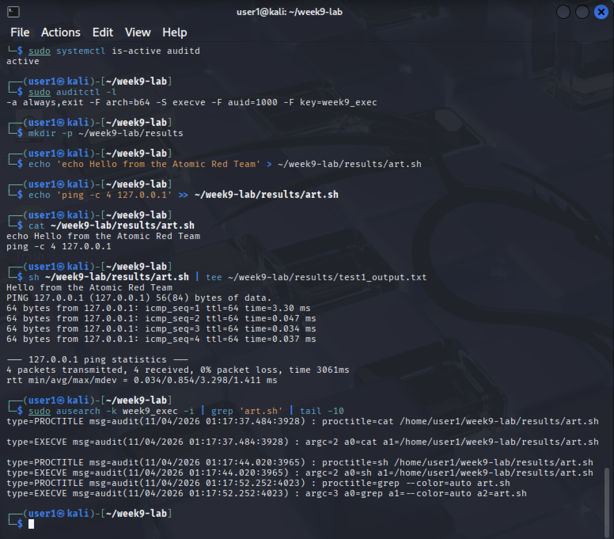
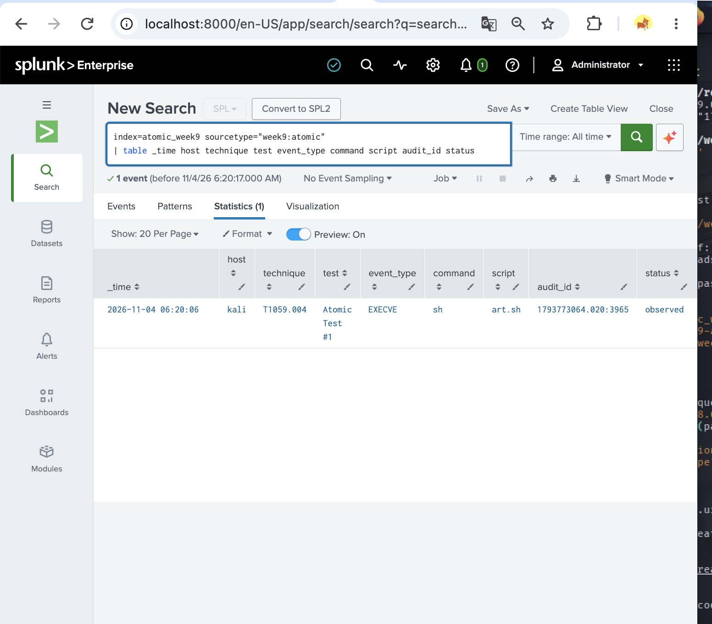
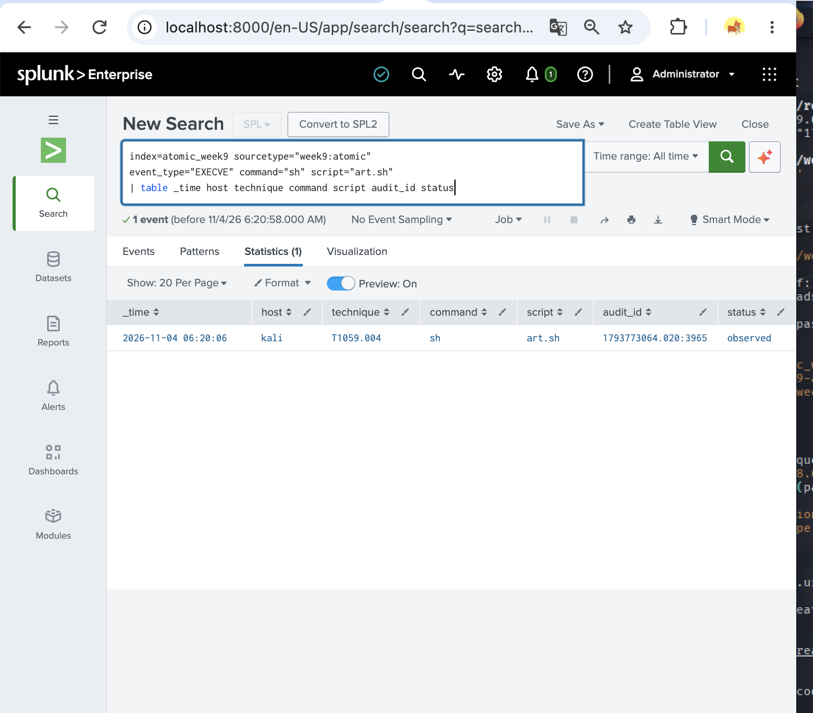
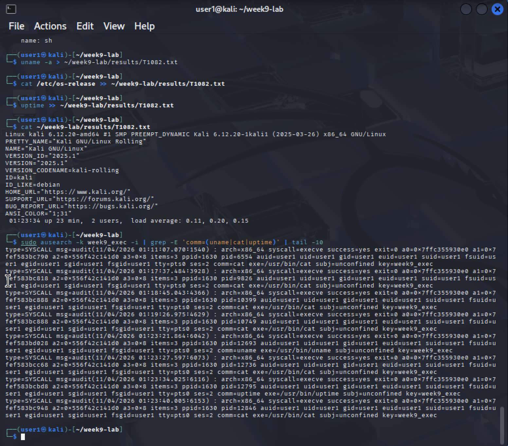
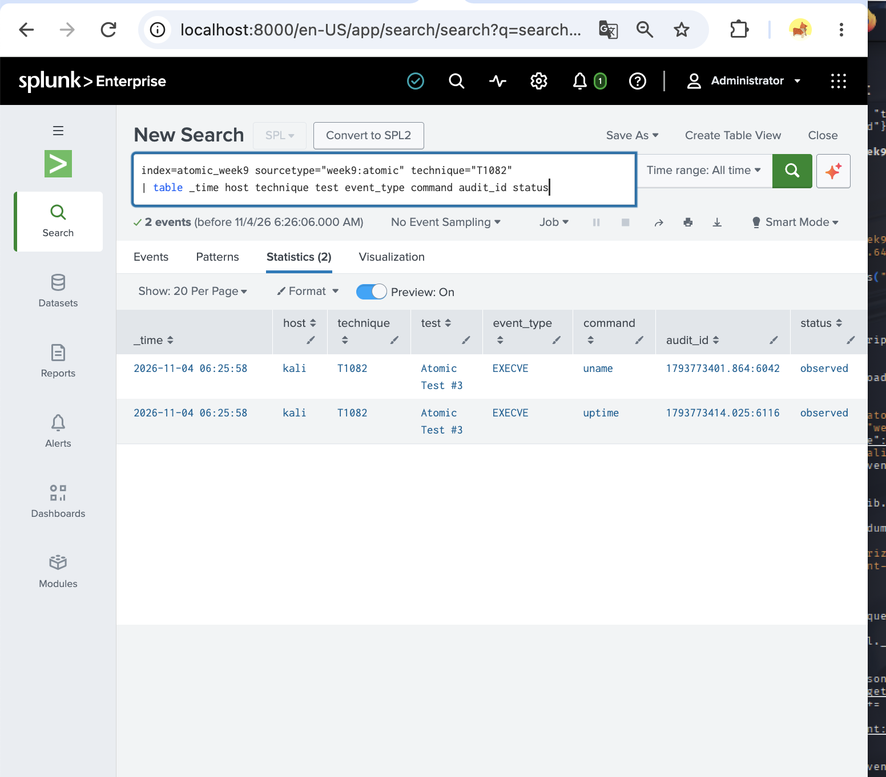
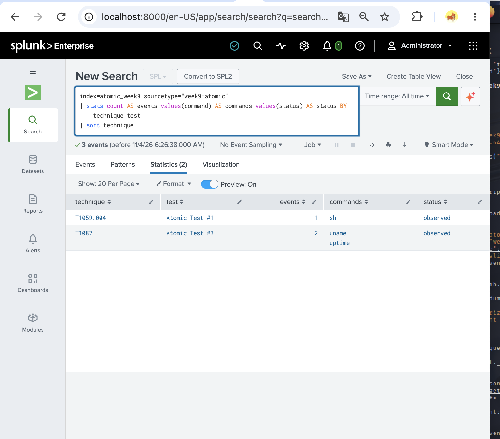
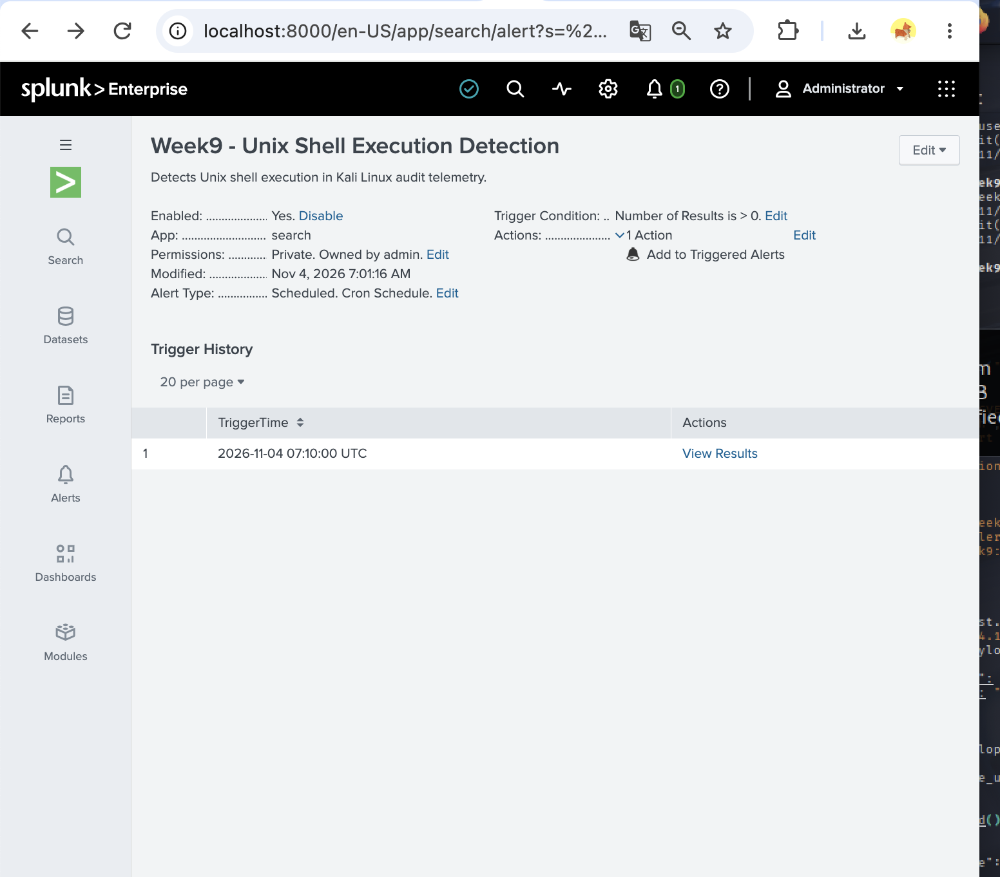
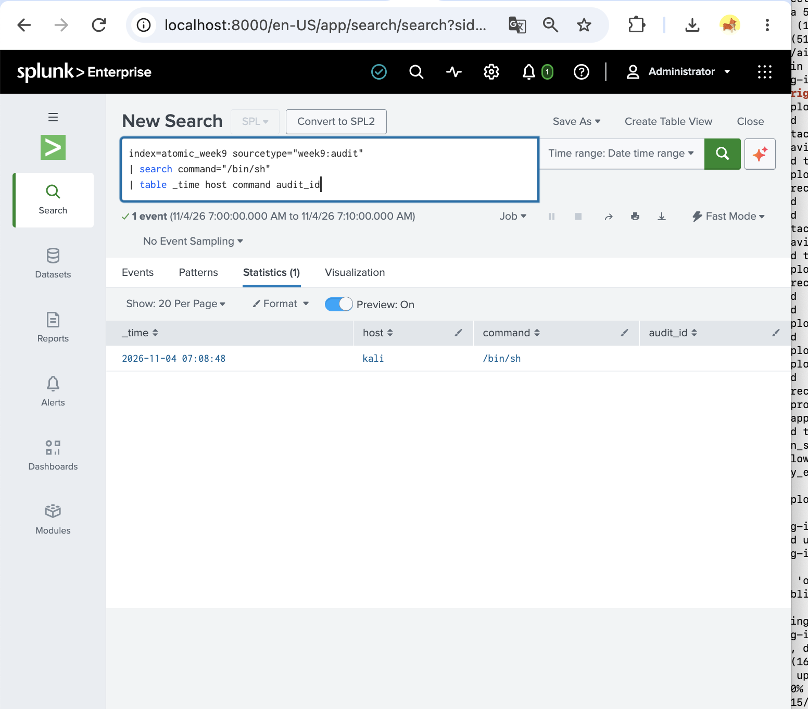

# Week 9 — Atomic Red Team: Phishing-Related Technique Simulation and SIEM Analysis

## 1. Introduction

This week focuses on Atomic Red Team, an open-source framework developed by Red Canary for testing security detection capabilities using techniques mapped to MITRE ATT&CK.

Our group project, **Cyber Threat Intelligence Analysis of Phishing Infrastructure**, investigates indicators and activities associated with phishing campaigns.

For Week 9, we performed two safe, adapted Atomic Red Team tests in an isolated Kali Linux virtual machine and analyzed the recorded events using Splunk Enterprise.

## 2. Objectives

- Understand the purpose of Atomic Red Team.
- Perform safe tests mapped to MITRE ATT&CK.
- Collect Linux process execution events using Auditd.
- Forward selected events to Splunk SIEM.
- Develop SPL queries to identify the test activities.
- Evaluate telemetry visibility and detection limitations.

## 3. Laboratory Environment

| Component | Configuration |
|---|---|
| Host OS | macOS Sequoia |
| Virtualization | UTM |
| Test Machine | Kali Linux 2025.1 |
| Architecture | x86_64 |
| Testing Framework | Atomic Red Team |
| Logging | Linux Audit (auditd) |
| SIEM | Splunk Enterprise |
| Containerization | Docker |
| Data Transfer | HTTP Event Collector (HEC) |
| Splunk Index | `atomic_week9` |

## 4. Methodology

The experiment followed these steps:

1. Prepared Kali Linux and Splunk Enterprise.
2. Installed and configured Linux Audit.
3. Enabled monitoring of process execution events.
4. Examined official Atomic Red Team test definitions.
5. Executed two safe, adapted test procedures.
6. Extracted relevant audit events.
7. Forwarded selected, sanitized events to Splunk through HEC.
8. Analyzed the results with SPL queries.

The experiments were conducted in a controlled educational environment without malicious payloads or credential extraction.

## 5. Executed Tests

### 5.1 T1059.004 — Command and Scripting Interpreter: Unix Shell

**Atomic Test #1: Create and Execute Bash Shell Script**

**Objective:** Demonstrate shell script execution and verify process execution logging.

A simple shell script was created to display a message and perform a local connectivity check using `127.0.0.1`.

The procedure was adapted from the official Atomic Red Team test.

**Observed results:**

- The shell script executed successfully.
- The connectivity check completed with four successful responses.
- Linux Audit recorded an `EXECVE` event for the shell execution.
- One selected event was forwarded to Splunk.

**SIEM result:** The execution event was successfully retrieved using an SPL search.

### 5.2 T1082 — System Information Discovery

**Atomic Test #3: List OS Information**

**Objective:** Demonstrate system information discovery and verify logging of the related commands.

The following commands were executed:

- `uname -a`
- `cat /etc/os-release`
- `uptime`

The commands collected operating system information, kernel information, and system uptime.

**Observed results:**

- System information was successfully collected.
- Linux Audit recorded process execution activity.
- Two selected events, corresponding to `uname` and `uptime`, were forwarded to Splunk.

**SIEM result:** Both events were successfully retrieved using SPL.

## 6. MITRE ATT&CK Mapping

| ATT&CK ID | Technique | Tactic | Relevance to Phishing |
|---|---|---|---|
| T1059.004 | Unix Shell | Execution | Shell commands may be executed after a successful phishing compromise |
| T1082 | System Information Discovery | Discovery | Attackers may collect system information after obtaining access |

The tests do not reproduce a complete phishing attack. They demonstrate post-access behaviors that can be relevant when investigating phishing-related incidents.

## 7. SIEM Detection Analysis

Linux Audit was configured to collect process execution events using the `execve` system call.

Selected events were processed and forwarded through Splunk HTTP Event Collector to the `atomic_week9` index.

### Detection Summary

| Technique | Executed | Audit Logs | Splunk Events | Result |
|---|---|---|---:|---|
| T1059.004 | Yes | Observed | 1 | Visible |
| T1082 | Yes | Observed | 2 | Visible |
| **Total** | **2 tests** | **Observed** | **3** | **2/2 visible** |

Both selected tests generated observable telemetry.

However, these results demonstrate event visibility and successful SPL searches rather than automated threat detection or alert generation.

## 8. Limitations

- Only two safe test procedures were evaluated.
- The tests were performed in a virtualized Linux environment.
- Selected audit records were manually processed and forwarded to Splunk.
- The experiments did not simulate a complete phishing attack.
- No automatic detection alert was evaluated.
- The event ingestion time and original audit execution time were not identical.

## 9. Experimental Evidence

The following screenshots document the execution of the adapted Atomic Red Team tests and the analysis of their events in Splunk SIEM.

### Test 1 — T1059.004: Unix Shell

**Test execution in Kali Linux:**

**Event received in Splunk:**

**SPL detection query results:**

### Test 2 — T1082: System Information Discovery

**Test execution and Linux Audit events:**

**Events received in Splunk:**

### Overall Detection Summary

Both selected tests generated observable process execution telemetry. The results confirm successful event collection and manual SPL validation, not automated threat alerts.

## Automated Detection Alert Validation

An additional scheduled alert was configured in Splunk Enterprise to monitor Unix shell execution events.

**Alert configuration:**

- Alert name: Week9 - Unix Shell Execution Detection
- Search index: `atomic_week9`
- Sourcetype: `week9:audit`
- Detection condition: `command="/bin/sh"`
- Schedule: Every 5 minutes
- Search window: Last 10 minutes
- Trigger condition: Number of Results greater than 0
- Action: Add to Triggered Alerts
- Severity: Medium

A synthetic validation event was submitted through Splunk HEC to test the alert.

**Observed results:**

- The validation event was successfully indexed.
- The scheduled search matched one event.
- Splunk recorded one automatic alert trigger on November 4, 2026, at 07:10 UTC.
- The matching event was visible through the View Results page.

**Conclusion:** The experiment successfully validated an automated Splunk alert using controlled test telemetry. This demonstrates rule execution and alert generation, but does not establish the ability to detect real phishing attacks.

### Alert Evidence

## Additional MITRE ATT&CK Analysis — T1003

**Technique:** T1003 — OS Credential Dumping  
**Tactic:** Credential Access  
**Analysis type:** Theoretical (not executed)

T1003 describes techniques used to obtain credential-related information from operating systems.

This activity may occur after an attacker gains initial access through phishing and attempts to expand access within an organization's environment.

### Potential Detection Indicators

- Unusual access to credential-related operating system resources.
- Suspicious process activity involving sensitive authentication components.
- Unexpected access attempts by unauthorized accounts.
- Security monitoring alerts related to credential access.

### Monitoring Recommendations

Organizations should collect relevant operating system security logs, monitor access to sensitive resources, apply least-privilege access controls, and investigate suspicious credential-related activity.

### Experiment Scope

T1003 was reviewed theoretically. No credential dumping commands were executed, and no passwords, hashes, or authentication secrets were collected.

The practical experiments remained focused on T1059.004 and T1082.

## 10. Conclusion

Week 9 demonstrated how Atomic Red Team procedures can support security monitoring validation.

Two techniques, T1059.004 and T1082, were tested in Kali Linux. Linux Audit recorded process execution events, and Splunk successfully received and retrieved three selected events.

The experiment confirmed telemetry visibility for both selected test procedures and highlighted the importance of process monitoring in phishing-related incident investigations.

## 11. References

1. Red Canary — Atomic Red Team: https://github.com/redcanaryco/atomic-red-team
2. MITRE ATT&CK — T1059.004: https://attack.mitre.org/techniques/T1059/004/
3. MITRE ATT&CK — T1082: https://attack.mitre.org/techniques/T1082/
4. Splunk Documentation: https://docs.splunk.com/

## 12. Use of AI

ChatGPT (OpenAI) was used to assist with understanding Atomic Red Team, interpreting Linux Audit events, preparing SPL queries, troubleshooting laboratory configuration, and improving documentation.

All reported practical results were obtained from the educational Kali Linux environment and verified using Linux Audit and Splunk Enterprise.

AI was used as a supporting tool and not as a replacement for practical experimentation or independent verification.